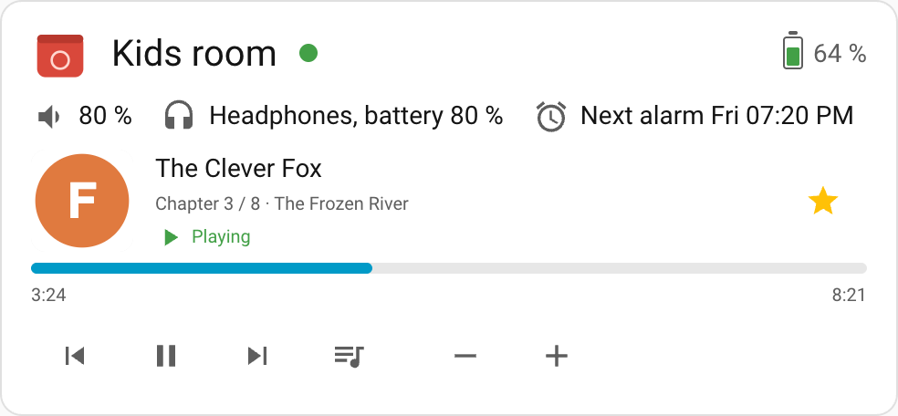
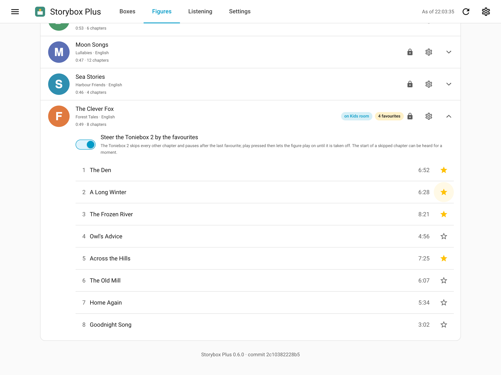

# Storybox Plus

A Home Assistant integration for the Toniebox. Every box becomes a device with the few entities automations need: is it online, how full is the battery, what plays, which figure was placed. The library of figures, their chapters, the listening times and how long a charge lasts live on a page in the sidebar, for administrators. The integration talks to the manufacturer's cloud, because the boxes have no local interface.

What it is for, for example:

- a sleep timer of 45 minutes as soon as the bedtime figure is placed;
- bedtimes with an alarm that rings on the chosen days: Home Assistant sets it on the box every evening, which the app does only once;
- favourite chapters: a figure starts with the chapters everybody loves, or plays only those;
- chapters of a creative figure uploaded, rearranged and removed from Home Assistant, also from a video link;
- the settings of a box, such as its name, maximum volume, light ring and tapping, changed on the page;
- how much was listened to, per figure, per chapter and per day, and when: per weekday and hour;
- playing, pausing, skipping, the volume and the sleep timer of a Toniebox 2 right on its card, and its headphones shown.

Everything it does, topic by topic: [What it does](docs/features.md).

This project is not affiliated with or endorsed by tonies GmbH. "Toniebox" and "Tonie" are their trademarks and are used here only to name the devices.

## Screenshots

The boxes with their live state; the Toniebox 2 with its bedtimes, its battery and the charge history, made up for these pictures:

The dashboard card of a Toniebox 2, here seen by a user without administrator rights:

A bought figure opened as its own page, with its favourite chapters:

More pictures of the page are in [The page and the dashboard card](docs/page-and-card.md).

## Documentation

| Document | What it holds |
|---|---|
| [What it does](docs/features.md) | How the integration is built, and each topic in turn: boxes, figures and chapters, favourites, repeat, bedtimes and the alarm, the night mode, listening times, sign-in and privacy. |
| [The page and the dashboard card](docs/page-and-card.md) | The page in the sidebar with its areas, the languages, and the dashboard card with its options and sizes. |
| [Automations and interface](docs/automations.md) | Example automations, and what automations, dashboards and scripts may build on: entities, actions, WebSocket commands, stores. |
| [Development](docs/development.md) | Setting up, the checks, the screenshots and how a release is made. |

## Known limitations

- The Toniebox 1 has no live data: no battery, no playback, no figure, not even whether it is online. It gets no device in Home Assistant; its settings are changed on the page. Whether it is online and its active time come only from a presence entity you choose, and are as exact as that entity.
- Everything goes through the manufacturer's cloud. Without internet, or when the cloud is down, the entities are unavailable; the boxes keep playing on their own.
- The box plays whatever figure stands on it; Home Assistant cannot choose a figure.
- The listening times count from the setup on; the cloud offers no history.
- Favourite chapters steer only a Toniebox 2 and only through the cloud; the start of a chapter that is left can be heard for a moment (about half a second on a box that is awake). A box that was asleep plays from where it was for about half a minute after it is woken, until it has reached the cloud; only then do its favourites begin.
- The alarm of a bedtime is set only while the box is online and Home Assistant runs; the box keeps one timer, so an alarm and a sleep timer exclude each other. The same holds for the wake-up light.
- Uploads go through Home Assistant's own file upload and take at most 100 MB per file. Which formats the cloud converts is its decision.
- The cloud's API is not documented for third parties. If the manufacturer changes it, this integration needs an update.

## Troubleshooting

- **"The cloud cannot be reached" during setup**: check the internet connection of Home Assistant; the sign-in server is `login.tonies.com`.
- **The entities are unavailable**: the cloud did not answer three polls in a row; the log names the error. The diagnostics show whether the push channel is connected (`push_connected`).
- **The media player shows nothing although the box plays**: the push channel may be reconnecting; the cloud drops it every few minutes. If it stays silent, download the diagnostics and open an issue.
- **A new sign-in is asked for**: the refresh token was refused, for example after a password change. Sign in again with the same account.
- **The link button is grey**: the Media Fetcher app is not installed or not started.
- **The alarm stays "set as soon as the box is online"**: the box is off or did not confirm; the log says when it did not. Switch the box on.
- **"An alarm of a bedtime rings at …" from the sleep timer**: a bedtime's alarm is due; switch its alarm off on the page first.
- **The page looks old after an update**: the script's address carries a hash of its content, so a restart of Home Assistant brings the new page; the companion app may need its frontend cache reset.
- **What happened with the cloud**: Setup → Log shows the integration's latest 500 lines, newest first, with buttons to copy them and to download every line kept. The log level (Debug, Info, Warning, Error; Info by default) is set there and kept across restarts, like the log level of an app. The lines are written to one file per day under `.storage/storybox_plus_log` and kept for 7 days by default (0 to 90; 0 writes nothing and the page shows the lines since the start only); older days are deleted, and removing the integration deletes them all. Info logs every change sent to the cloud (chapters, Tunes, settings) with its answer and time, and every Tune that came onto a figure or left it between two polls, also when the app did it; Debug adds every read, every push message and the token refreshes. A refused change is a warning. IDs are cut to their first six characters. The same lines go to Home Assistant's log; Home Assistant's own **Enable debug logging** on the integration's page still works and wins until it is turned off.

## Installation

Storybox Plus is part of the official catalog of the [Home Assistant Marketplace](https://www.home-assistant.io/integrations/marketplace/): you find it there by its name, with nothing to add first. There are three ways to install it, and each one is complete in itself. All need Home Assistant 2026.11 or later.

### Easy installation

Through the search in the Marketplace, the way for almost everyone.

1. Open **Settings → Marketplace** and search for **Storybox Plus**.
2. Install it and restart Home Assistant.
3. **Settings → Devices & services → Add integration → Storybox Plus** and sign in with the e-mail address and password of the app's account.
4. Optionally, for chapters from links, install the **Media Fetcher** app. It comes from an app repository of its own, [n-schilling/ha-app-media-fetcher](https://github.com/n-schilling/ha-app-media-fetcher): add that under **Settings → Apps → Install app → ⋮ → Repositories**, then install and start the app.

### Alternative installation

By the link of the repository, if the search does not show Storybox Plus.

1. Open **Settings → Marketplace → Add from link** (top right), enter `https://github.com/n-schilling/ha-storybox-plus` as GitHub link and add it. This asks you to connect GitHub once.
2. Install **Storybox Plus** and restart Home Assistant.
3. **Settings → Devices & services → Add integration → Storybox Plus** and sign in with the e-mail address and password of the app's account.
4. Optionally, for chapters from links, install the **Media Fetcher** app. It comes from an app repository of its own, [n-schilling/ha-app-media-fetcher](https://github.com/n-schilling/ha-app-media-fetcher): add that under **Settings → Apps → Install app → ⋮ → Repositories**, then install and start the app.

### Fully manual installation

Without the Marketplace, by copying the files yourself. Home Assistant then does not tell you about new versions: to update, repeat steps 1 to 4 with the newer release.

1. Open the [latest release](https://github.com/n-schilling/ha-storybox-plus/releases/latest) and download **Source code (zip)**.
2. Unpack it. Inside is the folder `custom_components/storybox_plus`.
3. Copy the folder `storybox_plus` into the `custom_components` folder of your configuration directory, the one that holds `configuration.yaml`, so that it ends up as `custom_components/storybox_plus`. Create `custom_components` if it does not exist yet.
4. Restart Home Assistant.
5. **Settings → Devices & services → Add integration → Storybox Plus** and sign in with the e-mail address and password of the app's account.
6. Optionally, for chapters from links, install the **Media Fetcher** app. It comes from an app repository of its own, [n-schilling/ha-app-media-fetcher](https://github.com/n-schilling/ha-app-media-fetcher): add that under **Settings → Apps → Install app → ⋮ → Repositories**, then install and start the app.

The integration has no options of its own; what can be chosen sits on the page, under Setup, the log level included.

### Removal

**Settings → Devices & services → Storybox Plus → ⋮ → Delete** removes the devices, the entities, the stores and the page. The cloud account is not changed; the token Home Assistant held simply expires. Then remove the integration in the Marketplace and restart. After a fully manual installation, delete the folder `custom_components/storybox_plus` instead and restart.

## Development

See [Development](docs/development.md).

## License

Apache License 2.0, see [LICENSE](LICENSE).
