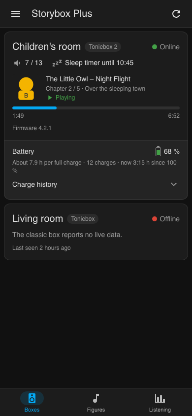

# Storybox Plus for Home Assistant

[](LICENSE)

A custom integration for the Toniebox: the boxes become devices with a few entities, the figures and the listening statistics live on their own page. It talks to the manufacturer's cloud, because the boxes have no local interface.

This project is not affiliated with or endorsed by tonies GmbH. "Toniebox" and "Tonie" are their trademarks and are used here only to name the devices.

## Why

The boxes are children's audio players; what a household wants from them in Home Assistant is small: is the box online, how full is the battery, what plays right now, and which figure was placed. Everything else, the library of figures, their chapters and the statistics, is something to look at, not to automate. So this integration keeps the entities few and puts the rest on a page.

## What it looks like

The screenshots show the page with invented data; the figures, names and times are not real products or recordings.

**Boxes**: every box with its live state. The Toniebox 2 shows battery, volume, sleep timer and what plays; the classic box only when it was last seen.


**Figures**: the household's library with search, a filter by kind, chapters and lengths, and which figure stands on a box right now.


**Listening**: the most played figures, the total listening time, listening per day and per box.


On a phone the tabs move to the bottom; dark themes are supported.



## Supported devices

| Device | Status |
|---|---|
| Toniebox 2 | Supported: online state, battery, charging, media player, figure event, listening statistics |
| Toniebox (classic) | Supported: online state only. The classic box reports nothing live to the cloud; nothing is simulated or guessed. |

Both generations can be mixed in one account. Figures (content Tonies, Creative-Tonies, discs) belong to the household, not to a box; the page shows them that way.

Requirements: Home Assistant 2026.10 or newer and an account of the manufacturer's app.

## Installation

1. In HACS: **⋮ → Custom repositories**, add `https://github.com/n-schilling/ha-storybox-plus` as type **Integration**.
2. Install **Storybox Plus** and restart Home Assistant.
3. **Settings → Devices & services → Add integration → Storybox Plus** and sign in with the account of the app.

### Installation parameters

| Parameter | Description |
|---|---|
| E-mail | The e-mail address of the account. |
| Password | Used once for the sign-in. Home Assistant stores only the resulting refresh token, which it renews itself. |

If the cloud stops accepting the token (after a password change, for example), Home Assistant asks for the sign-in again; it must be the same account.

### Configuration parameters

**Settings → Devices & services → Storybox Plus → Configure**:

| Option | Default | Description |
|---|---|---|
| Count listening time | on | Keeps daily sums of listening time per figure and box for the page. Switching it off deletes the sums. |

## Entities

Every box is a device. Only what automations can use becomes an entity:

| Entity | Boxes | Description |
|---|---|---|
| Connectivity (binary sensor) | all | Whether the box is connected to the cloud. The Toniebox 2 reports it live. For the classic box the cloud offers no connection state (and, for the accounts seen so far, no "last seen" either), so the sensor stays unknown rather than guessing; if the cloud reports when the box was last seen, it counts as connected for 30 minutes after that. |
| Battery (sensor) | Toniebox 2 | Battery level in percent. Unavailable while the box is switched off. |
| Charging (binary sensor) | Toniebox 2 | Whether the box charges. |
| Media player | Toniebox 2 | Playing, paused, idle (no figure) or off (box switched off). Shows the figure and chapter with the figure's picture, the position in the chapter and its length. |
| Figure (event) | Toniebox 2 | Fires `placed` or `removed` with the figure's ID and name. |

### Media player actions

The box plays whatever figure stands on it; Home Assistant cannot choose a figure. Supported:

- `media_player.media_play`, `media_player.media_pause`
- `media_player.volume_set`, `media_player.volume_up`, `media_player.volume_down` (the box has 13 levels)
- `media_player.media_next_track`, `media_player.media_previous_track` (chapters)
- `media_player.media_seek` (a position within the current chapter, so the progress bar of a media card works)

Example: pause the box in the children's room when the bedtime scene is activated.

```yaml
action: media_player.media_pause
target:
  entity_id: media_player.toniebox_kinderzimmer
```

Example: a notification when a figure is placed, with its name.

```yaml
triggers:
  - trigger: state
    entity_id: event.toniebox_kinderzimmer_figure
conditions:
  - condition: state
    entity_id: event.toniebox_kinderzimmer_figure
    attribute: event_type
    state: placed
actions:
  - action: notify.notify
    data:
      message: "{{ state_attr('event.toniebox_kinderzimmer_figure', 'tonie') }} is playing."
```

## The page

**Storybox Plus** in the sidebar, for administrators:

- **Boxes**: every box with its live state. For a Toniebox 2 also how long a charge lasts: every discharge from leaving the charger to the next charge, with the hours the box was switched on, the percent used and the projection for a full charge; the average of the latest charges on top.
- **Figures**: the household's library with search, a filter by kind, the chapters, and which figure stands on a box right now. The cloud names the chapters of bought figures but not their lengths; the lengths are learned from a Toniebox 2 the first time the figure plays on it, and kept.
- **Listening**: the most played figures, the total listening time, listening per day and per box, for the last 7, 30 or 365 days or since the setup. A note at the top says where the numbers come from: Home Assistant counts them itself, they are not read from the cloud.

The statistics are daily sums per figure and box, nothing more: no single plays, no times of day. The charge history keeps per discharge the day it ended, its hours and its percentages, also without times of day. They are kept in the integration's own store, not in the recorder, and start with the setup; the cloud offers no history. Only a Toniebox 2 reports playback, so only its listening is counted, and the page says so.

## How the data is updated

- The REST API is read every 5 minutes: households, boxes, figures and chapters, and the "last seen" of the classic box.
- The Toniebox 2 reports live through the cloud's push channel (MQTT over WebSocket): online state, battery, playback, volume. The channel is reconnected whenever the cloud drops it.
- A single failed poll keeps the last values; after three failed polls in a row the entities become unavailable, and recover with the next successful poll.

## Known limitations

- The classic box has no live data: no battery, no playback, no figure. Only its online state is shown.
- Everything goes through the manufacturer's cloud. Without internet, or when the cloud is down, the entities are unavailable; the boxes keep playing on their own.
- The listening statistics count from the setup on; there is no history before that.
- The cloud's API is not documented for third parties. If the manufacturer changes it, this integration needs an update.

## Troubleshooting

- **"The cloud cannot be reached" during setup**: check the internet connection of Home Assistant; the sign-in server is `login.tonies.com`.
- **The entities are unavailable**: the cloud did not answer three polls in a row. The log names the error. Also check the push channel in the diagnostics (`push_connected`).
- **The media player shows nothing although the box plays**: the push channel may be reconnecting (it is dropped every few minutes by the cloud and reconnected at once). If it stays silent, download the diagnostics and open an issue.
- **A new sign-in is asked for**: the refresh token was refused, for example after a password change. Sign in again with the same account.
- Debug logging: **Settings → Devices & services → Storybox Plus → ⋮ → Enable debug logging**. The log never contains tokens or the password.

## Removal

**Settings → Devices & services → Storybox Plus → ⋮ → Delete**. This removes the devices, the entities and the stored listening sums. The cloud account is not changed; the token Home Assistant held simply expires.

## Privacy and security

- Only a refresh token is stored, never the password. It is rotated with every refresh.
- No e-mail address, WLAN name or MAC address appears in a state or attribute. Diagnostics contain no tokens, names, addresses or listening data.
- Changes to the account (deleting chapters, resetting a box) are not offered as entities; where the page offers them, they are for administrators only.

## Development

```bash
uv venv --python 3.14 .venv
uv pip install --python .venv/bin/python -r requirements_test.txt
.venv/bin/ruff check . && .venv/bin/mypy custom_components && .venv/bin/pytest
```

The cloud access lives in `custom_components/storybox_plus/cloud/` and imports nothing from Home Assistant, so it can be tested on its own. Endpoints and payloads were learned from the official app and from the community project [HA-Toniebox](https://github.com/git4sim/HA-Toniebox) (MIT); the code here is written from scratch.

## License

Apache License 2.0, see [LICENSE](LICENSE).
