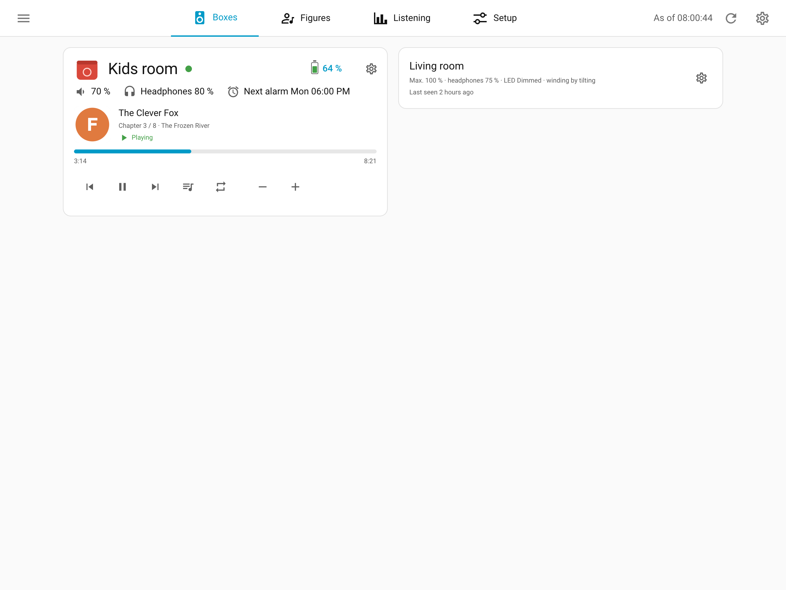
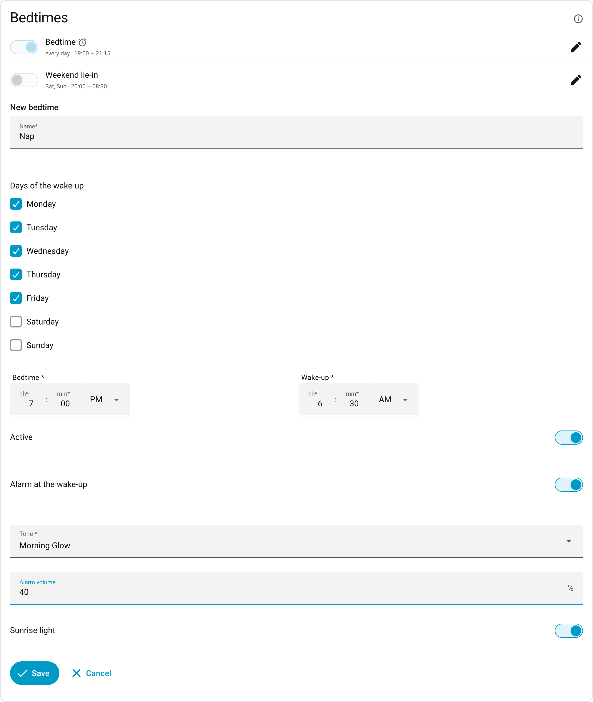
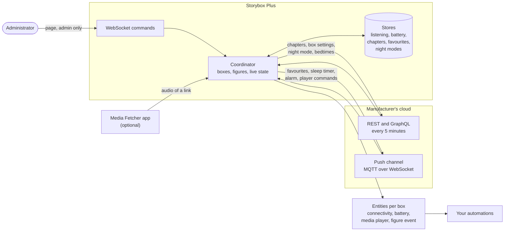
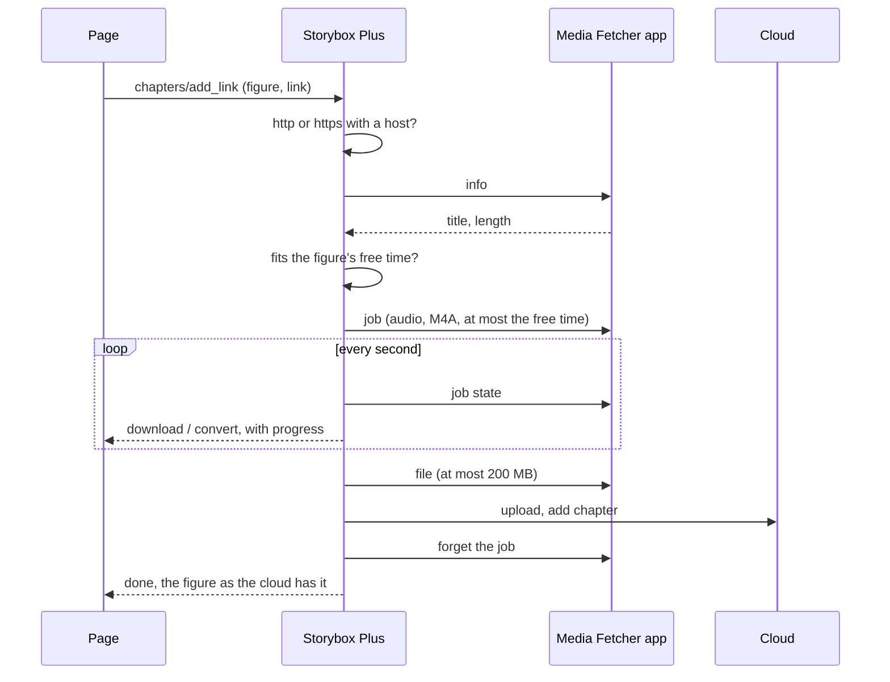
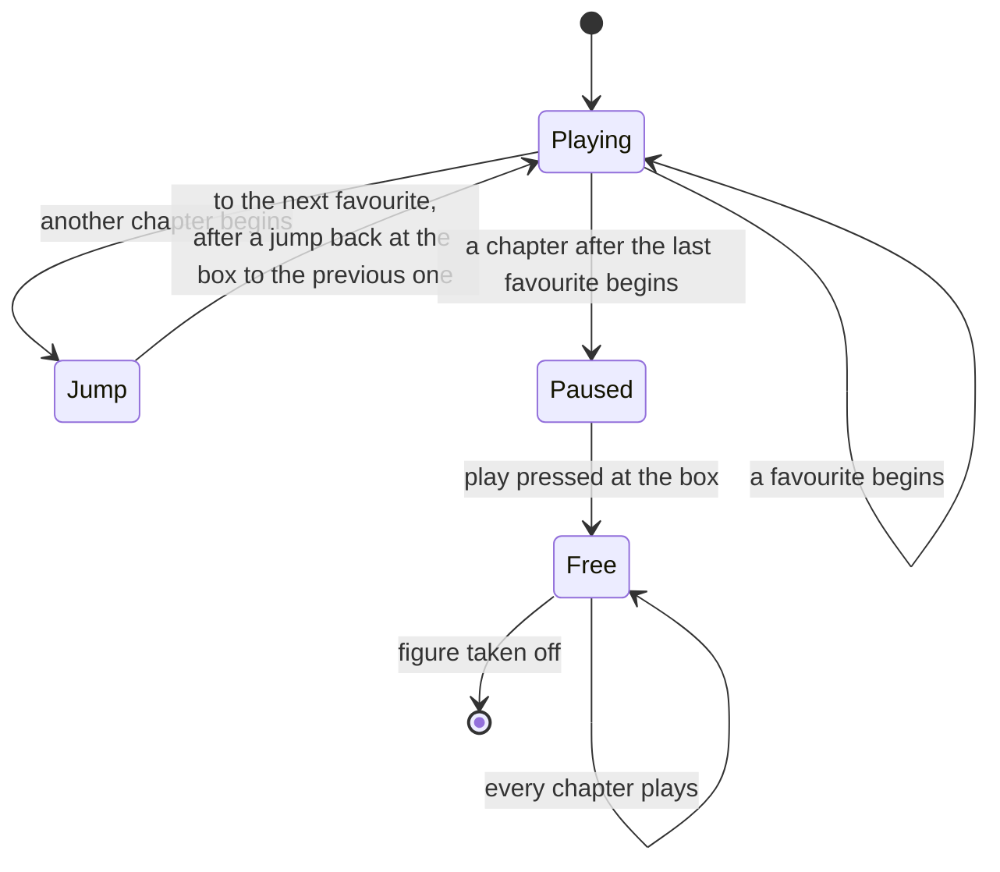
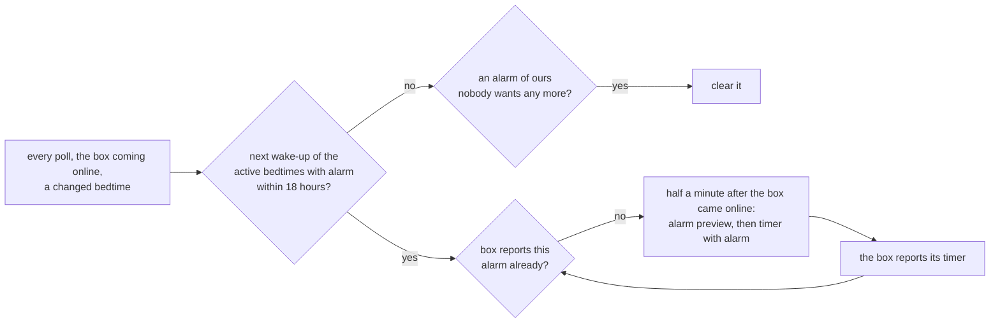
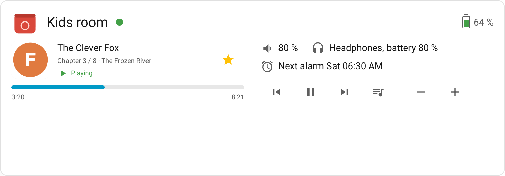

# Storybox Plus

[](#installation)


A Home Assistant integration for the Toniebox. Every box becomes a device with the few entities automations need: is it online, how full is the battery, what plays, which figure was placed. The library of figures, their chapters, the listening times and how long a charge lasts live on a page in the sidebar, for administrators. The integration talks to the manufacturer's cloud, because the boxes have no local interface.

What it is for, for example:

- a sleep timer of 45 minutes as soon as the bedtime figure is placed;
- bedtimes with an alarm that rings on the chosen days: Home Assistant sets it on the box every evening, which the app does only once;
- the bedtime scene pauses the box in the children's room;
- a notification when the battery of the box runs low, or a dashboard card with what plays;
- favourite chapters: the box skips the chapters nobody wants to hear;
- chapters of a creative figure uploaded, rearranged and removed from Home Assistant, also from a video link;
- the settings of a box, such as its name, maximum volume, light ring and tapping, changed on the page;
- a night mode for the light ring: dimmed from evening to morning, back to its normal brightness afterwards;
- a volume of its own per figure, for the loud one and the quiet one; the box's level comes back when it is taken off;
- any chapter of the figure on the box played from the media browser of a dashboard;
- the notifications the app keeps, for example a chapter that could not be converted, passed on to Home Assistant, and marked as read there if wanted;
- new bought figures and discs locked to the household on their own, so nobody claims them into another one;
- bought Tunes laid on a figure that fits and taken off again;
- how much was listened to, per figure, per chapter and per day, and when: per weekday and hour;
- playing, pausing, skipping, the volume and the sleep timer of a Toniebox 2 right on its card, and its headphones shown;
- Tunes vouchers redeemed and ready-made content put on a creative figure from a code.

This project is not affiliated with or endorsed by tonies GmbH. "Toniebox" and "Tonie" are their trademarks and are used here only to name the devices.

## Screenshots

The boxes with their live state; the Toniebox 2 with its bedtimes, its battery and the charge history, made up for these pictures:



The dashboard card of a Toniebox 2, here seen by a user without administrator rights:


The settings of a Toniebox 2 being changed, each with its (i), saved with the one button; a Toniebox 1 shows its own:


The night mode of the light ring, a view of the box:


The preferences of an account in the area Setup:


A new bedtime with its days, times and alarm:



A bought figure opened as its own page, with its favourite chapters:


The chapters of a creative figure being rearranged, sorted by title or shuffled; the changes go to the cloud together when saved:


The listening times of the last 30 days, counted by Home Assistant:


The boxes at phone width in dark mode:


## Design

### Overview



The REST API is read every 5 minutes: households, boxes, figures and chapters, and when the Toniebox 1 was last seen. A Toniebox 2 reports live through the push channel: online state, battery, playback, volume, sleep timer. Everything to the right of the entities is up to your automations.

### Boxes

| Device | What Home Assistant gets |
|---|---|
| Toniebox 2 | online state, battery, charging, media player, figure event, listening times, battery cycles, favourite chapters, repeat |
| Toniebox 1 | no entities: the Toniebox 1 reports nothing live to the cloud, not even whether it is online; nothing is simulated or guessed. Its settings are on the page. With a presence entity of your own (see [Settings of a box](#settings-of-a-box)) the page shows whether it is online. |

Both generations can be mixed in one account. Figures (bought figures, creative figures, discs) belong to the household, not to a box; the page shows them that way.

Members of one household may each add their own account. Every account then gets its own device and entities of the shared boxes; the page shows a shared box or figure once, through the account added first, and only that account counts its listening time.

A single failed poll keeps the last values; after three failed polls in a row the entities become unavailable and recover with the next successful poll. The push channel is reconnected whenever the cloud drops it; a message it cannot read is logged and skipped. A box that is missing from the account for an hour of polls loses its device and entities; a box that comes back gets them anew.

### Figures and chapters

The cloud names the chapters of bought figures but not their lengths; the lengths are learned from a Toniebox 2 the first time the figure plays on it, and kept. A box that knows nothing yet is asked again an hour later or when the figure is placed anew. Creative figures are always shown as the cloud describes them.

The chapters of a creative figure are changed on the page: audio files are uploaded as new chapters, and in the edit mode chapters are moved and removed. All changes go to the cloud together when saved, because every change makes the cloud convert the figure anew and a box download it again. While the cloud converts, the page reads the figure again every 15 seconds; chapters the cloud dropped (unsupported format, more than 90 minutes in total) are named.

A chapter can also come from a video link: the page takes the link, the Media Fetcher app fetches the audio, and the integration uploads it as a chapter named after the video while the page shows the progress.



A link that is no web address, or a video longer than the figure's free time, is refused before anything is fetched; playlists are not taken, one video at a time. Closing the page gives up a running fetch; reloading the integration ends it and tells the page.

Each chapter is renamed in the edit mode too (the pencil on its row); a new name converts nothing. Creative figures are renamed in the same edit mode, where also the app's **live mode** lives: the newest chapter plays first when the figure is placed, made for greetings such as a good-night message from a grandparent. Neither makes the cloud convert anything, so they go first and the chapters only when they changed. Sorting by title and shuffling rearrange the list in the edit mode, saved like moving by hand. **Remove all chapters** asks twice before it empties the list: whether all of them should go, and whether the audio files are kept somewhere else, because the cloud keeps no copy once the change is saved. Until saved, cancelling brings them back. Bought figures and discs keep the names they came with.

#### Shuffle on swap

A creative figure with several chapters can be shuffled whenever another figure replaces it on a Toniebox 2: its setting on the figure's page. Only a replacement counts: taken off and put back, the figure keeps where it was. The box reports an empty spot between two figures; the integration keeps the last figure per box across it, also in its store, so a restart in between loses nothing. A figure that stands on another box by then, or that a Tune lies on, is left alone. Every shuffle makes the cloud convert the figure anew, as rearranging by hand does.

### Tunes

Tunes are audio plays bought in the app that can be laid on fitting figures: the bought figures the cloud names as compatible, and every creative figure when the Tune fits them all. The page lists them per figure: one that lies on it, with a button to take it off, or the bought ones that fit, to lay one on. While a Tune lies on a creative figure, the figure keeps its own chapters; taken off, they play again. How often a Tune may still be laid on, the cloud decides; the page shows it.

### Volume per figure

Every figure can carry a volume level of its own (1 to 13, the box's steps), set on its page entry. When it is placed on a Toniebox 2, the integration remembers the level the box had and sets the figure's; taken off or replaced, the box gets the remembered level back exactly, whatever was turned at the box in between. A figure placed right after another one with a level starts from the level before that one, so a chain of figures never drifts. A level changed while the figure stands on a box applies at once.

The remembered levels live in the store, so a restart in between still restores them. As long as the box has not reported its level (right after the push channel came up), a figure's level is not set, because it could not be undone. Like everything live, it goes through the cloud: the first second of the figure plays at the old level.

### Notifications of the cloud

The cloud keeps notifications for the account that only the app shows: a chapter of a creative figure that could not be converted, an invitation to a household, news. Storybox Plus reads them with every poll and fires each unread one once on an event entity of the account (`event.<account>_cloud_notification`); an automation decides where it goes. The cloud's broadcasts to all users count the same. Which ones were passed on is kept in the store, so a restart repeats none. Under Setup → Preferences, **Mark notifications as read in the cloud once passed on** (off by default) also tidies the app: a passed-on notification is marked as read there, a broadcast is dismissed. Switched off, nothing changes in the cloud.

### Version of the cloud

The cloud's API is not documented for third parties and may change. Storybox Plus reads the version of the cloud's backend once an hour (it is public, no sign-in) and names it under Setup → Preferences. The cloud names its version as release and commit (`v2026.11.10/602b7aff2`); only the release counts. This version was tested with release **v2026.11.10**; when the cloud runs another release, the page says so, and the diagnostics carry it. Another release is no error: the cloud is updated often, mostly without changes to what the integration uses.

### Favourite chapters

Bought figures and discs take favourite chapters: a star on each chapter, and a switch per figure. While the switch is on and the figure plays on a Toniebox 2, the integration steers the box:



The box itself knows no selection; the integration sends it on through the cloud, so the start of a skipped chapter can be heard for a moment, and without the cloud or Home Assistant the box plays everything. Pressing play at the box after the pause behind the last favourite means the child wants to go on: the favourites stop steering that box for the figure, and every chapter plays, until the figure is taken off. Placed again, it is steered by its favourites again. The lists live in the integration's own store.

### Repeat

A Toniebox 2 repeats the figure on it as a whole, or one chapter of it: by the button on the box's card on the page (off, the whole figure, this chapter) or by the media player's own action `media_player.repeat_set` (`all`, `one`, `off`). The box itself knows no repeat; the integration sends it back through the cloud. With `all` the first chapter starts again once the figure has ended, or the first favourite chapter while favourites steer the figure. With `one` a chapter that ran out starts again as soon as the next one begins, so the beginning of the next chapter can be heard for a moment; a chapter skipped to by hand is left alone and is the one that repeats from then on. Without the cloud or Home Assistant the box plays on as it would.

The repeat belongs to the figure on the box and ends when it is taken off. It is kept in the integration's store, so it goes on after a restart of Home Assistant while that figure is still on the box. An end of the figure that Home Assistant did not see happen is not caught up: the box would start to play long after it fell silent.

### Locking figures to the household

A bought figure or disc that is locked cannot be claimed into another household, for example when it is lent to a friend. Every one has the setting on its page. Under Setup → Preferences, **Lock new figures and discs to the household** (on by default) locks a figure once, the first time it shows up in the account; unlocked on the page or in the app, it stays unlocked, because a figure is looked at only once. The figures already in the account at the first start stay as they are. Switched off, new figures are only noted, so switching it on later touches only those that come after. A lock the cloud refused is tried again with the next poll.

### Settings of a box

The page shows the settings each box has, as the cloud names them, and changes them in a form; only what changed is sent. Which ones a box has depends on its generation and its feature flags:

| Setting | Toniebox 2 | Toniebox 1 |
|---|---|---|
| name, maximum volume and maximum headphone volume | yes, any percent | yes, 25, 50, 75 or 100 % |
| light ring brightness; at bedtime: light ring, maximum volume and maximum headphone volume (percent) | yes | |
| skipping chapters by tapping, the ear that skips forward, winding by tilting | yes | |
| tilt and tap, tap direction, LED (on, dimmed, off) | | yes |
| age mode, language | with the box's feature flag | with the box's feature flag |

A new name reaches the box's device in Home Assistant at once, also one given in the app; a name given to the device in Home Assistant stays. The card shows the box in its colour, with the picture the app uses.

The box takes new settings the next time it is online; until then the page says it waits for the box. Offline mode is shown, not changed: the cloud does not take it. Resetting a box to its factory settings is left to the app.

A Toniebox 1 also takes a presence entity there: a device tracker of the box (from your router's integration, for example) or a binary sensor for connectivity, such as a ping. The cloud knows nothing live of a Toniebox 1; with the entity its card shows a dot for online or offline, unknown while the entity is unavailable. The entity is kept in Home Assistant only and creates no entity of its own. Without one, the box shows no state.

### Night mode of the light ring

A Toniebox 2 gets a night mode for its light ring: a span (from, until; across midnight when "until" comes first, in the box's time zone), a brightness for the span and one for the rest of the day. The integration sets the light ring when the span begins and when it ends; switched off during the span, the ring gets its normal brightness back at once.

It acts on the change only, not on every poll: a brightness set in the app in between stays until the next change. Which phase was set last is kept in the integration's store, so a change missed while Home Assistant was not running is made up at the next start, and one the cloud refused is sent again with the next poll. The box takes the new brightness the next time it is online.

### Bedtimes and the alarm

A Toniebox 2 knows bedtimes, as the app keeps them in the cloud: a name, the days, the time to sleep and the time to wake up, and whether an alarm rings then, with its volume and the morning light. The page lists them on the box's card with a switch each; they are added, changed and deleted there.

The box keeps one timer, and the alarm rings when that timer ends; the app sets it only once, so a bedtime alone makes no box ring again. Storybox Plus sets it itself:



- The days of a bedtime are the days of the wake-up; the times are the box's own time zone.
- The timer counts at most 18 hours (an unsigned 16-bit number of seconds), so the alarm is set from the afternoon before, as soon as the box is online. A box that stays off until the morning gets no alarm that night.
- What counts as set is what the box reports back, never what was sent. A box that does not confirm is asked three times, then again when it comes online anew; the log says so once.
- An alarm set by the integration for a wake-up no bedtime wants any more, because a bedtime was switched off, changed or deleted, is cleared. An alarm set in the app is left alone until a bedtime's alarm is due.
- While an alarm is due, the sleep timer actions and switching the box off are refused with the time of the alarm: each would replace the alarm.

### Listening times and battery

Home Assistant counts the listening time itself, from what a Toniebox 2 reports live: daily sums per figure and box, per chapter of a figure, per hour of the day per box, and how often each figure was placed; never single plays. The page ranks the most played figures and chapters and the figures placed most often, compares the period with the one of the same length before (once that one was counted in full), and shows when is listened to as a grid of weekdays and hours, for all boxes or one of them. They start with the setup; the Toniebox 1 and anything played while Home Assistant did not run are missing, and the page says so behind the (i) of the total. Counting is switched under Setup → Preferences, on by default; switching it off deletes the sums and sets the account up anew. How long the sums are kept is chosen there too: 1, 2 (default) or 5 years, or always; a shorter time deletes the older days at once.

A Toniebox 1 with a presence entity gets its active time instead, as a section of its own in the summary: how long it was in the network. It is an indication, not listening time, and enters none of the sums above: the box stays awake for some minutes after the last sound, the entity notices its leaving late, and a box in offline mode is not seen at all. For the first two, a lag is taken off the end of every stretch in the network: 20 minutes by default, measured with a router's device tracker as the time a box switched on without a figure stays in the network, and set per box (0 to 120 minutes) beside the entity. A stretch no longer than the lag counts nothing, and time is booked only once it is older than the lag. A restart of Home Assistant ends a stretch, so one that spans it loses the lag twice.

How long a charge lasts from now shows on the card, by the past charges: the level times the average full charge.

How long a charge lasts: every discharge from leaving the charger to the next charge, with the hours the box was switched on (only while the push channel tells so), the percent used and the projection for a full charge. Discharges shorter than 10 minutes or 5 percent are left out; the last 60 are kept.

### Sign-in and privacy

- The password is used once for the sign-in; only the refresh token is stored, and the cloud rotates it with every refresh. A refused token asks for a new sign-in of the same account.
- No e-mail address, WLAN name or MAC address appears in a state or attribute. Diagnostics contain no tokens, names, addresses or listening data; the log never contains tokens, the password or a request's body, and IDs in it are cut short.
- Changes to the account (chapters, favourites) are offered only on the page, which is for administrators only; the WebSocket commands refuse everybody else. Uploaded files are deleted from Home Assistant as soon as they are in the cloud.
- A link is fetched by the Media Fetcher app inside your Home Assistant, which the integration finds through the Supervisor's list of apps and reaches in the app network without a token; only audio is taken from it, and the file is deleted from the app once it is in the cloud. Whether a video may be copied onto a figure is between you, its owner and the platform's terms; the integration does not check that.

### Chapters from text

A creative figure takes a chapter from text: the page takes a title (or the first words) and the text, a voice of Home Assistant speaks it, and the recording is uploaded as a chapter. Without a choice that is Piper, the local voice (the Wyoming integration with Piper): the text never leaves the house then. Under Setup → Preferences any other text-to-speech entity of Home Assistant can be chosen, with one of its voices (its default voice until one is chosen); a voice of a cloud service gets the text to speak it, and a long text may exceed what it takes at once. A chosen entity that is unavailable is not replaced by another. Like links, this is optional: without a voice the button stays grey and says what is missing.

### The Media Fetcher app

Home Assistant's own container has no JavaScript runtime, which yt-dlp needs for most videos. So the fetching lives in the **Media Fetcher** app, a Home Assistant app of its own with yt-dlp, a runtime and ffmpeg. Install it under **Settings → Apps** and start it, and the page's link button comes alive; without it the button stays grey and says why. The app needs Home Assistant OS or a Supervised installation; without the Supervisor the integration works, only without links.

### Page

**Storybox Plus** in the sidebar, for administrators, built from Home Assistant's own elements in the frame of its settings pages, in four areas; each area's pages are tabs below the header, and a box or a figure opens as a page of its own with a back arrow:

- **Boxes** (`/storybox-plus/boxes/overview`): every box with its live state; a Toniebox 2 with volume, headphones, sleep timer, the next alarm, what plays, buttons to play, pause, skip chapters, open the list of chapters (a chapter chosen there plays from its start), repeat the figure or a chapter, change the volume and set or cancel a sleep timer of 30 or 60 minutes (left out while a bedtime's alarm is due), its battery's level and online or offline as a dot. A Toniebox 1 gets a small card: its settings in one line and when it was last seen. The cog of a box, or its battery's level, opens the box (`?key=<box>`) with its views **Settings** (with the firmware), **Night mode**, **Bedtimes** and **Battery** (with the charge history) (`&view=settings|night|bedtimes|battery`).
- **Figures**: **Figures** (`/figures/list`), the library with search over names and chapters and a filter by kind; a figure opens (`?key=<figure>`) with its views **Chapters** (favourite stars for bought figures, the edit mode for creative ones), **Settings** (name, live mode, volume, lock, steering by favourites, shuffling on swap), **Tune** and, for a creative figure, **Add** (files, YouTube, text). **Tunes** (`/figures/tunes`): the bought Tunes, redeeming a voucher and content from a code.
- **Listening**: **Summary** (the total with the comparison, the most played figures and chapters, the figures placed most often, the sums per box) and **Times** (a chart per day, per week over long spans, and when is listened to by weekday and hour), for 7, 30 or 365 days or since the setup.
- **Setup**: **Overview** (the steps with their state: account loaded, household named, preferences chosen, and the optional Media Fetcher app and Piper voice; Continue leads to the first open one; the version of the integration at the bottom), **Household** (its name and its members, shown only as the cloud shows them, managed in the app), **Preferences** (counting the listening time and how long it is kept, locking new figures, marking notifications as read, the speech entity and voice for text chapters, the largest file taken from a link, the cloud's version) and **Log** (the log level, how many days the lines are kept, the latest lines and a download). A new household name also becomes the entry's title and the account device's name, as long as the title was still the household's name.

Settings are rows with their explanation behind an (i); one save button appears while something differs from what is saved. Errors read one line by their kind, Home Assistant's message behind the (i). Numbers follow the number format of the user's profile, and number fields take a point or a comma. Addresses of before (`#figures`, `#preferences`, …) lead to the page that took their place; opened without an address while no account is loaded, the page starts at the setup.

At the end of the header: when the open page's data came ("As of 14:53:23", left out on a phone), a refresh button that asks the integration again without reloading the page and spins while it waits, and the button to the integration's page in Home Assistant. The boxes ask again every 10 seconds by themselves, and the stamp follows. On a phone the areas move to a bar at the bottom.

### Dashboard card

The card of a Toniebox 2 from the page, for any dashboard: `custom:storybox-plus-box-card`, offered in the card picker as **Storybox Plus · Toniebox**. It loads with the integration; there is no resource to add.

```yaml
type: custom:storybox-plus-box-card
entity: media_player.kids_room
```

It shows what the page's card shows (online or offline, the battery's level, volume, headphones, the sleep timer, the next alarm, the night mode at work, what plays) and has the same buttons: play, pause, skip chapters, louder and quieter, a sleep timer of 30 or 60 minutes. It leaves out what only administrators see: the settings, the bedtimes and the charge history.

Each part can be left out, in the card's editor or in its YAML; all of them show unless turned off:

| Option | Leaves out when `false` |
|---|---|
| `show_picture` | the picture of the box in the head |
| `show_battery` | the battery's level in the head |
| `show_volume` | the volume |
| `show_headphones` | the headphones while connected |
| `show_sleep_timer` | a running sleep timer |
| `show_next_alarm` | the next alarm of a bedtime |
| `show_night_mode` | the chip of the light ring's night mode at work |
| `show_playback` | the figure that plays, its chapter and progress |
| `show_controls` | the buttons |

The name and the dot for online or offline always show.

The card takes any width from a quarter of a section on (half by default); its height follows the content. It lays itself out by the width it gets: from 600 px what plays stands beside the facts and buttons, so it fits a wide, low tile such as half of a wall display (748 × 262 px); narrower it stacks, tighter, and still fits 370 × 262 px; under 300 px it is compact.



Every user who may read the box's media player sees the card, not only administrators; the buttons are the media player's actions and `storybox_plus.set_sleep_timer`. The card asks the integration again when the media player changes and every 30 seconds.

## Examples

Pause the box in the children's room with the bedtime scene:

```yaml
triggers:
  # A scene's state is the time it was last activated
  - trigger: state
    entity_id: scene.bedtime
    not_to: unavailable
actions:
  - action: media_player.media_pause
    target:
      entity_id: media_player.kids_room
```

A 45-minute sleep timer when the bedtime figure is placed, cancelled when a figure is taken off:

```yaml
triggers:
  - trigger: state
    entity_id: event.kids_room_figure
actions:
  - choose:
      - conditions:
          - "{{ trigger.to_state.attributes.event_type == 'placed' and trigger.to_state.attributes.tonie_id == 'ID OF THE FIGURE' }}"
        sequence:
          - action: storybox_plus.set_sleep_timer
            target:
              entity_id: media_player.kids_room
            data:
              minutes: 45
      - conditions:
          - "{{ trigger.to_state.attributes.event_type == 'removed' }}"
        sequence:
          - action: storybox_plus.clear_sleep_timer
            target:
              entity_id: media_player.kids_room
```

A notification when the battery runs low and the box is not on the charger:

```yaml
triggers:
  - trigger: numeric_state
    entity_id: sensor.kids_room_battery
    below: 15
conditions:
  - condition: state
    entity_id: binary_sensor.kids_room_charging
    state: "off"
actions:
  - action: notify.notify
    data:
      message: "The box in the kids' room needs charging."
```

## Known limitations

- The Toniebox 1 has no live data: no battery, no playback, no figure, not even whether it is online. It gets no device in Home Assistant; its settings are changed on the page. Whether it is online and its active time come only from a presence entity you choose, and are as exact as that entity.
- Everything goes through the manufacturer's cloud. Without internet, or when the cloud is down, the entities are unavailable; the boxes keep playing on their own.
- The box plays whatever figure stands on it; Home Assistant cannot choose a figure.
- The listening times count from the setup on; the cloud offers no history.
- Favourite chapters work only on a Toniebox 2 and only through the cloud.
- The alarm of a bedtime is set only while the box is online and Home Assistant runs; the box keeps one timer, so an alarm and a sleep timer exclude each other. The alarm tone is the one the app chose, or the app's first; the page does not choose tones.
- Uploads go through Home Assistant's own file upload and take at most 100 MB per file. Which formats the cloud converts is its decision.
- The cloud's API is not documented for third parties. If the manufacturer changes it, this integration needs an update.

## Troubleshooting

- **"The cloud cannot be reached" during setup**: check the internet connection of Home Assistant; the sign-in server is `login.tonies.com`.
- **The entities are unavailable**: the cloud did not answer three polls in a row; the log names the error. The diagnostics show whether the push channel is connected (`push_connected`).
- **The media player shows nothing although the box plays**: the push channel may be reconnecting; the cloud drops it every few minutes. If it stays silent, download the diagnostics and open an issue.
- **A new sign-in is asked for**: the refresh token was refused, for example after a password change. Sign in again with the same account.
- **The link button is grey**: the Media Fetcher app is not installed or not started.
- **The alarm stays "set as soon as the box is online"**: the box is off or did not confirm; the log says when it did not. Switch the box on.
- **"An alarm of a bedtime rings at …" from the sleep timer**: a bedtime's alarm is due; switch its alarm off on the page first.
- **The page looks old after an update**: the script's address carries a hash of its content, so a restart of Home Assistant brings the new page; the companion app may need its frontend cache reset.
- **What happened with the cloud**: Setup → Log shows the integration's latest 500 lines, newest first, with buttons to copy them and to download every line kept. The log level (Debug, Info, Warning, Error; Info by default) is set there and kept across restarts, like the log level of an app. The lines are written to one file per day under `.storage/storybox_plus_log` and kept for 7 days by default (0 to 90; 0 writes nothing and the page shows the lines since the start only); older days are deleted, and removing the integration deletes them all. Info logs every change sent to the cloud (chapters, Tunes, settings) with its answer and time, and every Tune that came onto a figure or left it between two polls, also when the app did it; Debug adds every read, every push message and the token refreshes. A refused change is a warning. IDs are cut to their first six characters. The same lines go to Home Assistant's log; Home Assistant's own **Enable debug logging** on the integration's page still works and wins until it is turned off.

## Interface

What automations and dashboards can build on. Before 1.0.0 it may still change between minor versions.

### Entities

IDs as created in English, for a box named "Kids room". Every unique ID starts with the config entry (`<entry>`), and a box's device is `(storybox_plus, <entry>_<box>)` with the box's ID from the cloud: members of one household who each add their own account get a device of the shared box per account instead of a collision.

| Entity | Unique ID | Boxes | State |
|---|---|---|---|
| `binary_sensor.kids_room_connectivity` | `<entry>_<box>_connectivity` | Toniebox 2 | connected to the cloud; unknown while nothing tells |
| `sensor.kids_room_battery` | `<entry>_<box>_battery` | Toniebox 2 | battery in percent; unavailable while the box is switched off |
| `binary_sensor.kids_room_charging` | `<entry>_<box>_charging` | Toniebox 2 | charging |
| `binary_sensor.<account>_live_channel` | `<entry>_live_channel` | the account's device, with a Toniebox 2 | the push channel is connected; live state and commands of every Toniebox 2 go through it |
| `media_player.kids_room` | `<entry>_<box>` | Toniebox 2 | `playing`, `paused`, `idle` (no figure), `off` (switched off) with figure, chapter, picture, position and length |
| `event.kids_room_figure` | `<entry>_<box>_figure` | Toniebox 2 | event types `placed`, `removed` with `tonie_id` and `tonie` (name) |
| `event.<account>_cloud_notification` | `<entry>_notification` | the account's device | event type `notification` with `kind` (the cloud's type, `system` for a broadcast), `text`, `time`, `tonie_id`, `tonie`, `reason` (why a conversion failed) |

The media player takes play, pause, volume (13 levels), next and previous chapter, repeat (the whole figure or one chapter, see [Repeat](#repeat)), seeking within the chapter, playing a chapter of the figure on the box picked from the media browser (`media_player.play_media` with `chapter:<figure>:<index from 0>`; a chapter of another figure is refused), and turning off, which puts the box to sleep as the app's sleep button does; the cloud cannot wake it again.

### Actions

| Action | Fields | Description |
|---|---|---|
| `storybox_plus.set_sleep_timer` | `minutes` (1 to 1092) | the box falls asleep on its own after that time; a running timer is replaced |
| `storybox_plus.clear_sleep_timer` | none | cancels the running timer |

Both target the media player of a Toniebox 2. While the alarm of a bedtime is due, they and turning the media player off are refused, because each would replace the alarm.

### WebSocket commands

For administrators only, but one; the page uses them. Their answers serve the page and are not part of this interface. `storybox_plus/box/card` (`entity_id` of a box's media player) serves the dashboard card: it answers every user who may read that entity, with the box's live state and nothing of its settings.

| Command | Parameters |
|---|---|
| `storybox_plus/overview` | none; boxes with their live state, the version, and per account the Piper entity that speaks while none is chosen (`speech_auto`) |
| `storybox_plus/library` | none; households and figures with chapters and favourites, the bought Tunes, whether links can be fetched and whether a voice can speak |
| `storybox_plus/analytics` | `days` (or none for all), `limit` |
| `storybox_plus/chapters/arrange` | `tonie_id`, `chapters` (IDs in the new order; the rest is removed), optional `titles` (chapter ID → new name) |
| `storybox_plus/chapters/add_text` | `tonie_id`, `text` (up to 5000 characters), optional `title` (else the first words); the account's voice speaks it |
| `storybox_plus/chapters/add` | `tonie_id`, `file_id` (from `/api/file_upload`), optional `title` |
| `storybox_plus/chapters/add_link` | `tonie_id`, `url`; a subscription that reports the stages |
| `storybox_plus/favourites/set` | `tonie_id`, `chapters` (positions from 0), `active` |
| `storybox_plus/figure/refresh` | `tonie_id` |
| `storybox_plus/figure/update` | `tonie_id` (a creative figure) and `name` and/or `live` |
| `storybox_plus/figure/shuffle_on_swap` | `tonie_id` (a creative figure), `enabled` |
| `storybox_plus/household/rename` | `household_id`, `name`; answers with the entry's title |
| `storybox_plus/figure/tune` | `tonie_id`, `tune_id` (from the library's `tunes`, or null to take the Tune off); answers with the Tunes and the figure |
| `storybox_plus/box/command` | `box_id` (a Toniebox 2), `command` (`play`, `pause`, `next`, `previous`, `chapter` with `value` as its index from 0, `volume` with `value` 0 to 13, `sleep` with `value` in minutes, `sleep_clear`) |
| `storybox_plus/box/repeat` | `box_id` (a Toniebox 2 with a figure on it), `mode` (`all`, `one` or null for off); answers with the box |
| `storybox_plus/voucher/redeem` | `entry_id`, `code`; answers with how many Tunes it brought and the Tunes |
| `storybox_plus/figure/redeem_token` | `tonie_id` (a creative figure), `token`; answers with the figure |
| `storybox_plus/figure/lock` | `tonie_id` (a bought figure or disc), `locked` |
| `storybox_plus/preferences/set` | `entry_id` and any of `analytics`, `auto_lock`, `mark_read`, `analytics_days` (365, 730, 1825 or 0 for always), `speech_engine` (a `tts` entity; null: Piper), `voice` with `voice_language` (null: the engine's default), `fetch_max_mb` (10–2000); switching `analytics` sets the account up anew |
| `storybox_plus/log` | optional `limit`; the log level, the days kept and the latest lines, newest first (without a limit, all lines kept) |
| `storybox_plus/log/set` | any of `level` (`debug`, `info`, `warning`, `error`), `days` (0–90) |
| `storybox_plus/figure/volume` | `tonie_id`, `level` (1 to 13, or null for the box's own volume) |
| `storybox_plus/bedtime/save` | `box_id`, optional `schedule_id` (none: a new bedtime, which needs `sleep_time`, `wakeup_time`, `days`), `name`, `sleep_time` and `wakeup_time` (`HH:MM`), `days` (`monday` … `sunday`), `enabled`, `alarm_enabled`, `alarm_volume` (0 to 100), `alarm_morning_light`; answers with the box |
| `storybox_plus/bedtime/delete` | `box_id`, `schedule_id`; answers with the box |
| `storybox_plus/night/set` | `box_id`, `enabled`, `start` and `end` (`HH:MM`, not the same), `night` and `day` (0 to 100); a Toniebox 2 only; answers with the box |
| `storybox_plus/box/settings` | `box_id` and any of `name`, `max_volume`, `max_headphone_volume` (1 to 100; a Toniebox 1 only 25, 50, 75, 100), `lightring_brightness`, `bedtime_lightring_brightness` (0 to 100), `bedtime_max_volume`, `bedtime_max_headphone_volume` (1 to 100), `skipping_enabled`, `skipping_direction` and `tap_direction` (`left`, `right`), `scrubbing_enabled`, `accelerometer_enabled`, `led_level` (`on`, `dimmed`, `off`), `age_mode`, `language`; a setting the box does not have is refused; answers with the box; for a Toniebox 1 also `presence_entity` (a `device_tracker` or `binary_sensor` entity, or null) and `presence_lag` (minutes, 0 to 120), both kept in Home Assistant only |

### Stores

`.storage/storybox_plus.<entry>.analytics` (daily sums per figure and box, per chapter, per hour), `.battery` (charges), `.chapters` (chapters learned from the boxes), `.favourites`, `.night` (night modes with the phase set last), `.volumes` (levels per figure and the levels to restore per box), `.notices` (the cloud's notifications passed on), `.settings` (the preferences and the figures looked at for locking) and `.shuffle` (the figures shuffled on swap and the last figure per box), version 1 each. Deleting the entry deletes them.

## Installation

1. **Settings → Marketplace → Add from link** (top right), enter `https://github.com/n-schilling/ha-storybox-plus` as GitHub link and add it. Adding a repository by link asks you to connect GitHub once.
2. Install **Storybox Plus** in the Marketplace and restart Home Assistant.
3. **Settings → Devices & services → Add integration → Storybox Plus** and sign in with the e-mail address and password of the app's account.
4. Optionally install the **Media Fetcher** app under **Settings → Apps** for chapters from links.

Requires Home Assistant 2026.11 or later. Without the Marketplace, copy `custom_components/storybox_plus` into the `custom_components` folder of your configuration directory and restart.

The integration has no options of its own; what can be chosen sits on the page, under Setup, the log level included.

### Removal

**Settings → Devices & services → Storybox Plus → ⋮ → Delete** removes the devices, the entities, the stores and the page. The cloud account is not changed; the token Home Assistant held simply expires. Then remove the integration in the Marketplace and restart.

## Development

```bash
uv venv --python 3.14 && uv pip install -r requirements_test.txt
scripts/check.sh
```

`scripts/check.sh` runs what CI runs: ruff, the changelog and translation checks, mypy, the tests with their coverage threshold, the page checks and hassfest in Docker (`--no-page`, `--no-hassfest` leave them out). The page check is not part of CI: run `scripts/check.sh` before a release that changes the page.

The cloud access lives in `custom_components/storybox_plus/cloud/` and imports nothing from Home Assistant, so it can be tested on its own; its README collects what is known about the API. Endpoints and payloads were learned from the official app and from the community project [HA-Toniebox](https://github.com/git4sim/HA-Toniebox) (MIT); the code here is written from scratch.

The page checks start a throwaway Home Assistant, reachable from this machine only, whose integration talks to a made-up cloud (`scripts/panel/demo_cloud.py`: one household, a Toniebox 2 that plays and confirms its alarm, a Toniebox 1, invented figures, bedtimes, listening times and charges). They drive the page in a headless browser (Home Assistant's frame with the four areas and each page's tab on every page, the header's stamp, refresh and integration button, old addresses and a change of the query alone, boxes and figures as subpages with a back arrow, settings rows with their (i) and the one save button for box settings, night mode, figure settings, the household and the preferences, bedtimes added, switched and deleted, the charge history by keyboard, search and the kind filter, favourites, rearranging, uploading and removing all chapters, a Tune laid on and taken off, a voucher refused with one error line and redeemed, content from a code, the listening summary and times with their words for screen readers, the setup steps, numbers and a comma typed back in German, counting switched off and on, the start at the setup without a loaded account, the dashboard card, phone width in dark mode, no page for non-administrators) and stop Home Assistant again. They need their own environment:

```bash
uv venv --python 3.14 .venv-panel && uv pip install --python .venv-panel/bin/python -r requirements_panel.txt
```

They use an installed Google Chrome, otherwise Playwright's Chromium (`.venv-panel/bin/python -m playwright install chromium`). The pictures in this README come from the same run:

```bash
.venv-panel/bin/python -I scripts/panel/check_panel.py --screenshots docs/screenshots
```

Releases: CI runs on `dev`; once it is green, push that commit to `main`. CI does not run again there: the release workflow checks that CI passed for the commit, then tags the version from `manifest.json` and publishes a GitHub release with its CHANGELOG section; the Marketplace offers it as an update. While the repository is private the workflow stops after that check: the first release is the public one.

For testing on a Home Assistant OS host before a release (copies the files, writes the deployed commit for the page and restarts Home Assistant):

```bash
scripts/deploy.sh <ssh-host>
```

The page shows the version and that commit at the bottom; `-dirty` marks files that differ from it.

## License

Apache License 2.0, see [LICENSE](LICENSE).
