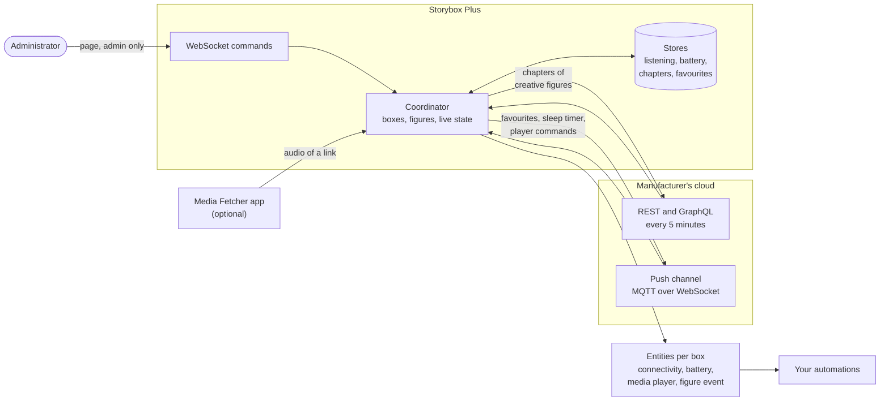
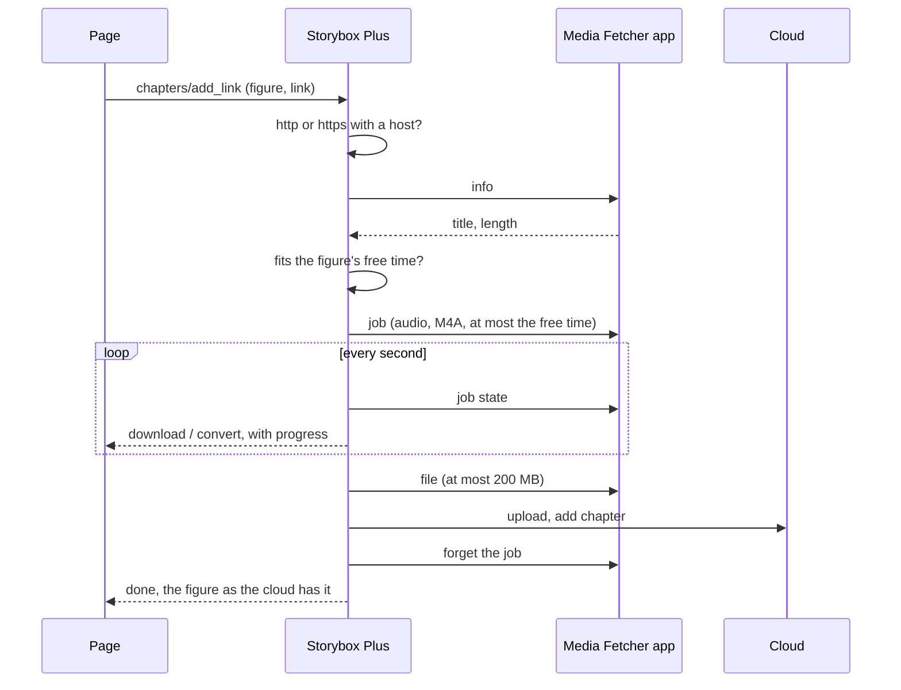
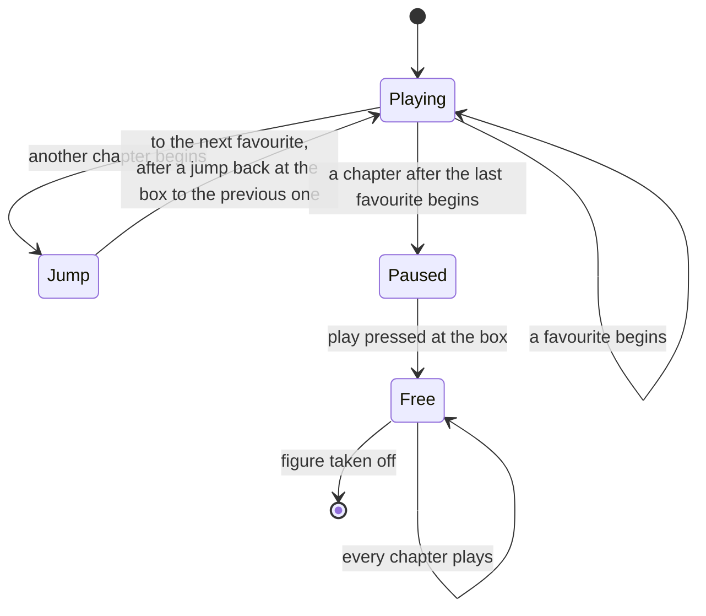

# Storybox Plus

[](#installation)

A Home Assistant integration for the Toniebox. Every box becomes a device with the few entities automations need: is it online, how full is the battery, what plays, which figure was placed. The library of figures, their chapters, the listening times and how long a charge lasts live on a page in the sidebar, for administrators. The integration talks to the manufacturer's cloud, because the boxes have no local interface.

What it is for, for example:

- a sleep timer of 45 minutes as soon as the bedtime figure is placed;
- the bedtime scene pauses the box in the children's room;
- a notification when the battery of the box runs low, or a dashboard card with what plays;
- favourite chapters: the box skips the chapters nobody wants to hear;
- chapters of a creative figure uploaded, rearranged and removed from Home Assistant, also from a video link;
- how much was listened to, per figure and per day.

This project is not affiliated with or endorsed by tonies GmbH. "Toniebox" and "Tonie" are their trademarks and are used here only to name the devices.

## Screenshots

The boxes with their live state; the Toniebox 2 with its battery and the charge history, made up for these pictures:


The figures of the household; a bought figure opened, with its favourite chapters and the switch that steers the box:


A creative figure being rearranged; the changes go to the cloud together when saved:


The listening times of the last 30 days, counted by Home Assistant:


The boxes at phone width in dark mode:


## Design

### Overview



The REST API is read every 5 minutes: households, boxes, figures and chapters, and when the classic box was last seen. A Toniebox 2 reports live through the push channel: online state, battery, playback, volume, sleep timer. Everything to the right of the entities is up to your automations.

### Boxes

| Device | What Home Assistant gets |
|---|---|
| Toniebox 2 | online state, battery, charging, media player, figure event, listening times, battery cycles, favourite chapters |
| Toniebox (classic) | online state only. The classic box reports nothing live to the cloud; nothing is simulated or guessed. |

Both generations can be mixed in one account. Figures (bought figures, creative figures, discs) belong to the household, not to a box; the page shows them that way.

A single failed poll keeps the last values; after three failed polls in a row the entities become unavailable and recover with the next successful poll. The push channel is reconnected whenever the cloud drops it; a message it cannot read is logged and skipped. A box that is missing from the account for an hour of polls loses its device and entities; a box that comes back gets them anew.

### Figures and chapters

The cloud names the chapters of bought figures but not their lengths; the lengths are learned from a Toniebox 2 the first time the figure plays on it, and kept. A box that knows nothing yet is asked again an hour later or when the figure is placed anew. Creative figures are always shown as the cloud describes them.

The chapters of a creative figure are changed on the page: audio files are uploaded as new chapters, and in the edit mode chapters are moved and removed. All changes go to the cloud together when saved, because every change makes the cloud convert the figure anew and a box download it again. While the cloud converts, the page reads the figure again every 15 seconds; chapters the cloud dropped (unsupported format, more than 90 minutes in total) are named.

A chapter can also come from a video link: the page takes the link, the Media Fetcher app fetches the audio, and the integration uploads it as a chapter named after the video while the page shows the progress.



A link that is no web address, or a video longer than the figure's free time, is refused before anything is fetched; playlists are not taken, one video at a time. Closing the page gives up a running fetch; reloading the integration ends it and tells the page.

### Favourite chapters

Bought figures and discs take favourite chapters: a star on each chapter, and a switch per figure. While the switch is on and the figure plays on a Toniebox 2, the integration steers the box:



The box itself knows no selection; the integration sends it on through the cloud, so the start of a skipped chapter can be heard for a moment, and without the cloud or Home Assistant the box plays everything. Pressing play at the box after the pause behind the last favourite means the child wants to go on: the favourites stop steering that box for the figure, and every chapter plays, until the figure is taken off. Placed again, it is steered by its favourites again. The lists live in the integration's own store.

### Listening times and battery

Home Assistant counts the listening time itself, from what a Toniebox 2 reports live: daily sums per figure and box, nothing more (no single plays, no times of day). They start with the setup; the classic box and anything played while Home Assistant did not run are missing, and the page says so above the numbers. Counting is an option, on by default; switching it off deletes the sums.

How long a charge lasts: every discharge from leaving the charger to the next charge, with the hours the box was switched on (only while the push channel tells so), the percent used and the projection for a full charge. Discharges shorter than 10 minutes or 5 percent are left out; the last 60 are kept.

### Sign-in and privacy

- The password is used once for the sign-in; only the refresh token is stored, and the cloud rotates it with every refresh. A refused token asks for a new sign-in of the same account.
- No e-mail address, WLAN name or MAC address appears in a state or attribute. Diagnostics contain no tokens, names, addresses or listening data; the log never contains tokens or the password.
- Changes to the account (chapters, favourites) are offered only on the page, which is for administrators only; the WebSocket commands refuse everybody else. Uploaded files are deleted from Home Assistant as soon as they are in the cloud.
- A link is fetched by the Media Fetcher app inside your Home Assistant, which the integration finds through the Supervisor's list of apps and reaches in the app network without a token; only audio is taken from it, and the file is deleted from the app once it is in the cloud. Whether a video may be copied onto a figure is between you, its owner and the platform's terms; the integration does not check that.

### The Media Fetcher app

Home Assistant's own container has no JavaScript runtime, which yt-dlp needs for most videos. So the fetching lives in the **Media Fetcher** app, a Home Assistant app of its own with yt-dlp, a runtime and ffmpeg. Install it under **Settings → Apps** and start it, and the page's link button comes alive; without it the button stays grey and says why. The app needs Home Assistant OS or a Supervised installation; without the Supervisor the integration works, only without links.

### Page

**Storybox Plus** in the sidebar, for administrators, built from Home Assistant's own elements:

- **Boxes**: every box with its live state; a Toniebox 2 with volume, sleep timer, what plays, and its battery with the charge history.
- **Figures**: the library with search over names and chapters, a filter by kind, which figure stands on a box, the chapters with their lengths, favourites for bought figures and the tools for creative ones.
- **Listening**: the most played figures, the total, a chart per day (per week over long spans) and the sums per box, for 7, 30 or 365 days or since the setup.

The header carries, as on every page of the shared standard, when the open tab's data came ("As of 14:53:23", left out on a phone), a refresh button that asks the integration again without reloading the page and spins while it waits, and a settings button to the integration's page under **Settings → Devices & services**. The boxes tab asks again every 10 seconds by itself, and the stamp follows.

At the bottom it shows the version of the integration. On a phone the tabs move to the bottom.

## Examples

Pause the box in the children's room with the bedtime scene:

```yaml
triggers:
  # A scene's state is the time it was last activated
  - trigger: state
    entity_id: scene.bedtime
    not_to: unavailable
actions:
  - action: media_player.media_pause
    target:
      entity_id: media_player.kids_room
```

A 45-minute sleep timer when the bedtime figure is placed, cancelled when a figure is taken off:

```yaml
triggers:
  - trigger: state
    entity_id: event.kids_room_figure
actions:
  - choose:
      - conditions:
          - "{{ trigger.to_state.attributes.event_type == 'placed' and trigger.to_state.attributes.tonie_id == 'ID OF THE FIGURE' }}"
        sequence:
          - action: storybox_plus.set_sleep_timer
            target:
              entity_id: media_player.kids_room
            data:
              minutes: 45
      - conditions:
          - "{{ trigger.to_state.attributes.event_type == 'removed' }}"
        sequence:
          - action: storybox_plus.clear_sleep_timer
            target:
              entity_id: media_player.kids_room
```

A notification when the battery runs low and the box is not on the charger:

```yaml
triggers:
  - trigger: numeric_state
    entity_id: sensor.kids_room_battery
    below: 15
conditions:
  - condition: state
    entity_id: binary_sensor.kids_room_charging
    state: "off"
actions:
  - action: notify.notify
    data:
      message: "The box in the kids' room needs charging."
```

## Known limitations

- The classic box has no live data: no battery, no playback, no figure. Only its online state is shown, and only while the cloud tells when it was last seen.
- Everything goes through the manufacturer's cloud. Without internet, or when the cloud is down, the entities are unavailable; the boxes keep playing on their own.
- The box plays whatever figure stands on it; Home Assistant cannot choose a figure.
- The listening times count from the setup on; the cloud offers no history.
- Favourite chapters work only on a Toniebox 2 and only through the cloud.
- Uploads go through Home Assistant's own file upload and take at most 100 MB per file. Which formats the cloud converts is its decision.
- The cloud's API is not documented for third parties. If the manufacturer changes it, this integration needs an update.

## Troubleshooting

- **"The cloud cannot be reached" during setup**: check the internet connection of Home Assistant; the sign-in server is `login.tonies.com`.
- **The entities are unavailable**: the cloud did not answer three polls in a row; the log names the error. The diagnostics show whether the push channel is connected (`push_connected`).
- **The media player shows nothing although the box plays**: the push channel may be reconnecting; the cloud drops it every few minutes. If it stays silent, download the diagnostics and open an issue.
- **A new sign-in is asked for**: the refresh token was refused, for example after a password change. Sign in again with the same account.
- **The link button is grey**: the Media Fetcher app is not installed or not started.
- **The page looks old after an update**: the script's address carries a hash of its content, so a restart of Home Assistant brings the new page; the companion app may need its frontend cache reset.
- Debug logging: **Settings → Devices & services → Storybox Plus → ⋮ → Enable debug logging**.

## Interface

What automations and dashboards can build on. Before 1.0.0 it may still change between minor versions.

### Entities

IDs as created in English, for a box named "Kids room"; the unique IDs use the box's ID from the cloud, which is also the device identifier `(storybox_plus, <box>)`.

| Entity | Unique ID | Boxes | State |
|---|---|---|---|
| `binary_sensor.kids_room_connectivity` | `<box>_connectivity` | all | connected to the cloud; unknown while nothing tells |
| `sensor.kids_room_battery` | `<box>_battery` | Toniebox 2 | battery in percent; unavailable while the box is switched off |
| `binary_sensor.kids_room_charging` | `<box>_charging` | Toniebox 2 | charging |
| `media_player.kids_room` | `<box>` | Toniebox 2 | `playing`, `paused`, `idle` (no figure), `off` (switched off) with figure, chapter, picture, position and length |
| `event.kids_room_figure` | `<box>_figure` | Toniebox 2 | event types `placed`, `removed` with `tonie_id` and `tonie` (name) |

The media player takes play, pause, volume (13 levels), next and previous chapter, seeking within the chapter, and turning off, which puts the box to sleep as the app's sleep button does; the cloud cannot wake it again.

### Actions

| Action | Fields | Description |
|---|---|---|
| `storybox_plus.set_sleep_timer` | `minutes` (1 to 1092) | the box falls asleep on its own after that time; a running timer is replaced |
| `storybox_plus.clear_sleep_timer` | none | cancels the running timer |

Both target the media player of a Toniebox 2.

### WebSocket commands

For administrators only; the page uses them. Their answers serve the page and are not part of this interface.

| Command | Parameters |
|---|---|
| `storybox_plus/overview` | none; boxes with their live state and the version |
| `storybox_plus/library` | none; households and figures with chapters and favourites, whether links can be fetched |
| `storybox_plus/analytics` | `days` (or none for all), `limit` |
| `storybox_plus/chapters/arrange` | `tonie_id`, `chapters` (IDs in the new order; the rest is removed) |
| `storybox_plus/chapters/add` | `tonie_id`, `file_id` (from `/api/file_upload`), optional `title` |
| `storybox_plus/chapters/add_link` | `tonie_id`, `url`; a subscription that reports the stages |
| `storybox_plus/favourites/set` | `tonie_id`, `chapters` (positions from 0), `active` |
| `storybox_plus/figure/refresh` | `tonie_id` |

### Stores

`.storage/storybox_plus.<entry>.analytics` (daily sums), `.battery` (charges), `.chapters` (chapters learned from the boxes) and `.favourites`, version 1 each. Deleting the entry deletes them.

## Installation

1. **Settings → Marketplace → Add from link** (top right), enter `https://github.com/n-schilling/ha-storybox-plus` as GitHub link and add it. Adding a repository by link asks you to connect GitHub once.
2. Install **Storybox Plus** in the Marketplace and restart Home Assistant.
3. **Settings → Devices & services → Add integration → Storybox Plus** and sign in with the e-mail address and password of the app's account.
4. Optionally install the **Media Fetcher** app under **Settings → Apps** for chapters from links.

Requires Home Assistant 2026.11 or later. Without the Marketplace, copy `custom_components/storybox_plus` into the `custom_components` folder of your configuration directory and restart.

**Settings → Devices & services → Storybox Plus → Configure** has one option: **Count listening time** (on). Switching it off deletes the sums.

### Removal

**Settings → Devices & services → Storybox Plus → ⋮ → Delete** removes the devices, the entities, the stores and the page. The cloud account is not changed; the token Home Assistant held simply expires. Then remove the integration in the Marketplace and restart.

## Development

```bash
uv venv --python 3.14 && uv pip install -r requirements_test.txt
scripts/check.sh
```

`scripts/check.sh` runs what CI runs: ruff, the changelog and translation checks, mypy, the tests with their coverage threshold, the page checks and hassfest in Docker (`--no-page`, `--no-hassfest` leave them out).

The cloud access lives in `custom_components/storybox_plus/cloud/` and imports nothing from Home Assistant, so it can be tested on its own; its README collects what is known about the API. Endpoints and payloads were learned from the official app and from the community project [HA-Toniebox](https://github.com/git4sim/HA-Toniebox) (MIT); the code here is written from scratch.

The page checks start a throwaway Home Assistant, reachable from this machine only, whose integration talks to a made-up cloud (`scripts/panel/demo_cloud.py`: one household, a Toniebox 2 that plays, a classic box, invented figures, listening times and charges). They drive the page in a headless browser (boxes, charge history, the header's stamp, refresh on every tab and settings button, search and filter, favourites and their switch, rearranging and uploading chapters, the link button without the app, listening times, phone width in dark mode, no page for non-administrators) and stop Home Assistant again. They need their own environment:

```bash
uv venv --python 3.14 .venv-panel && uv pip install --python .venv-panel/bin/python -r requirements_panel.txt
```

They use an installed Google Chrome, otherwise Playwright's Chromium (`.venv-panel/bin/python -m playwright install chromium`). The pictures in this README come from the same run:

```bash
.venv-panel/bin/python -I scripts/panel/check_panel.py --screenshots docs/screenshots
```

Releases: CI on `main` tags the version from `manifest.json` and publishes a GitHub release with its CHANGELOG section; the Marketplace offers it as an update.

For testing on a Home Assistant OS host before a release (copies the files, writes the deployed commit for the page and restarts Home Assistant):

```bash
scripts/deploy.sh <ssh-host>
```

The page shows the version and that commit at the bottom; `-dirty` marks files that differ from it.

## License

Apache License 2.0, see [LICENSE](LICENSE).
