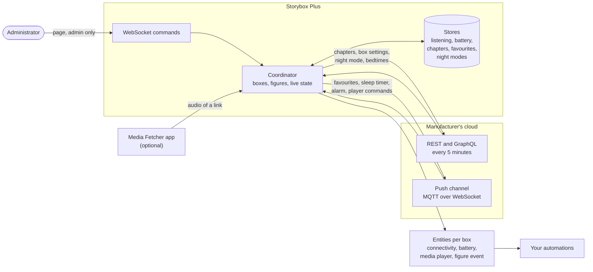
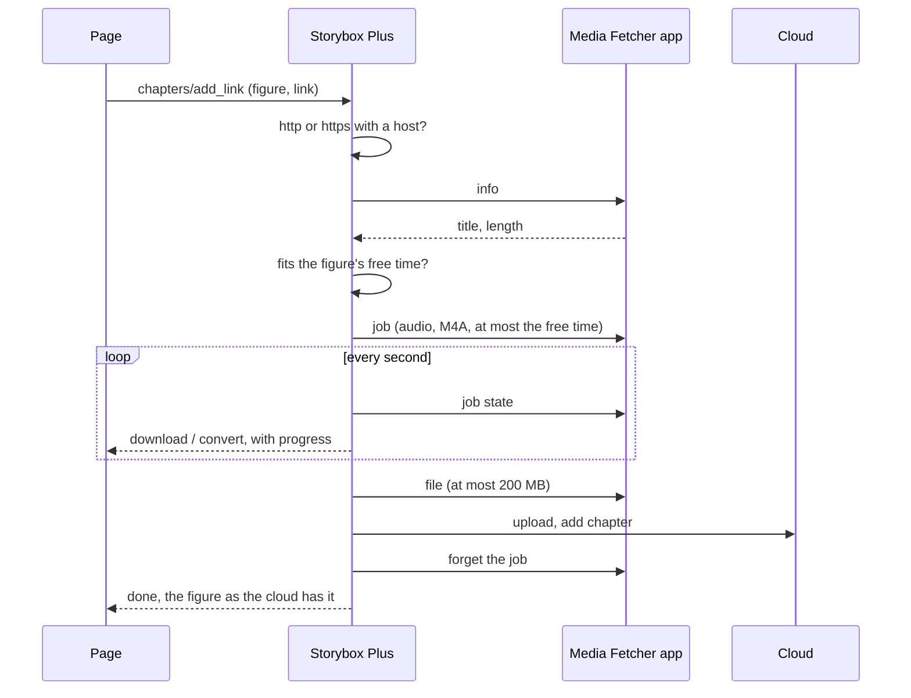
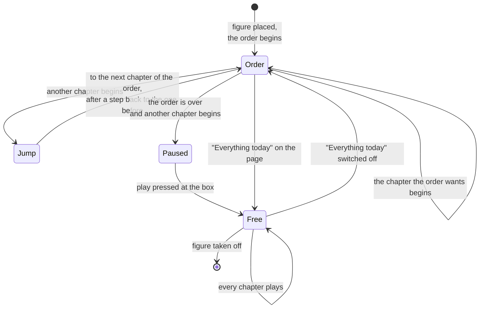
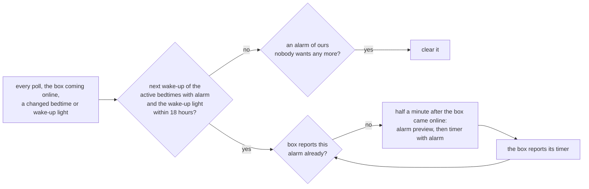

# Storybox Plus: what it does

How the integration is built, and each topic in turn. Back to the [README](../README.md).

## Overview

The REST API is read every 5 minutes: households, boxes, figures and chapters, and when the Toniebox 1 was last seen. A Toniebox 2 reports live through the push channel: online state, battery, playback, volume, sleep timer. Everything to the right of the entities is up to your automations.

## Boxes

| Device | What Home Assistant gets |
|---|---|
| Toniebox 2 | online state, battery, charging, media player, figure event, listening times, battery cycles, favourite chapters, repeat |
| Toniebox 1 | no entities: the Toniebox 1 reports nothing live to the cloud, not even whether it is online; nothing is simulated or guessed. Its settings are on the page. With a presence entity of your own (see [Settings of a box](#settings-of-a-box)) the page shows whether it is online. |

Both generations can be mixed in one account. Figures (bought figures, creative figures, discs) belong to the household, not to a box; the page shows them that way.

Members of one household may each add their own account. Every account then gets its own device and entities of the shared boxes; the page shows a shared box or figure once, through the account added first, and only that account counts its listening time.

A single failed poll keeps the last values; after three failed polls in a row the entities become unavailable and recover with the next successful poll. The push channel is reconnected whenever the cloud drops it; a message it cannot read is logged and skipped. A box that is missing from the account for an hour of polls loses its device and entities; a box that comes back gets them anew.

## Figures and chapters

The cloud names the chapters of bought figures but not their lengths; the lengths are learned from a Toniebox 2 the first time the figure plays on it, and kept. A box that knows nothing yet is asked again an hour later or when the figure is placed anew. Creative figures are always shown as the cloud describes them.

The chapters of a creative figure are changed on the page: audio files are uploaded as new chapters, and in the edit mode chapters are moved and removed. All changes go to the cloud together when saved, because every change makes the cloud convert the figure anew and a box download it again. While the cloud converts, the page reads the figure again every 15 seconds; chapters the cloud dropped (unsupported format, more than 90 minutes in total) are named.

A chapter can also come from a video link: the page takes the link, the Media Fetcher app fetches the audio, and the integration uploads it as a chapter named after the video while the page shows the progress.

A link that is no web address, or a video longer than the figure's free time, is refused before anything is fetched; playlists are not taken, one video at a time. Closing the page gives up a running fetch; reloading the integration ends it and tells the page.

Each chapter is renamed in the edit mode too (the pencil on its row); a new name converts nothing. Creative figures are renamed in the same edit mode, where also the app's **live mode** lives: the newest chapter plays first when the figure is placed, made for greetings such as a good-night message from a grandparent. Neither makes the cloud convert anything, so they go first and the chapters only when they changed. Sorting by title and shuffling rearrange the list in the edit mode, saved like moving by hand. **Remove all chapters** asks twice before it empties the list: whether all of them should go, and whether the audio files are kept somewhere else, because the cloud keeps no copy once the change is saved. Until saved, cancelling brings them back. Bought figures and discs keep the names they came with.

### Shuffle on swap

A creative figure with several chapters can be shuffled whenever another figure replaces it on a Toniebox 2: its setting on the figure's page. Only a replacement counts: taken off and put back, the figure keeps where it was. The box reports an empty spot between two figures; the integration keeps the last figure per box across it, also in its store, so a restart in between loses nothing. A figure that stands on another box by then, or that a Tune lies on, is left alone. Every shuffle makes the cloud convert the figure anew, as rearranging by hand does.

## Tunes

Tunes are audio plays bought in the app that can be laid on fitting figures: the bought figures the cloud names as compatible, and every creative figure when the Tune fits them all. The page lists them per figure: one that lies on it, with a button to take it off, or the bought ones that fit, to lay one on. While a Tune lies on a creative figure, the figure keeps its own chapters; taken off, they play again. How often a Tune may still be laid on, the cloud decides; the page shows it.

## Volume per figure

Every figure can carry a volume level of its own (1 to 13, the box's steps), set on its page entry. When it is placed on a Toniebox 2, the integration remembers the level the box had and sets the figure's; taken off or replaced, the box gets the remembered level back exactly, whatever was turned at the box in between. A figure placed right after another one with a level starts from the level before that one, so a chain of figures never drifts. A level changed while the figure stands on a box applies at once.

The 13 levels are relative to the box's **maximum volume** (a setting of the box): level 13 is that maximum, not the loudest the box can play, and every level below is a share of it. A figure therefore never plays louder than the maximum allows; to make a quiet figure louder than that, raise the maximum of the box.

The remembered levels live in the store, so a restart in between still restores them. As long as the box has not reported its level (right after the push channel came up), a figure's level is not set, because it could not be undone. Like everything live, it goes through the cloud: the first second of the figure plays at the old level.

## Notifications of the cloud

The cloud keeps notifications for the account that only the app shows: a chapter of a creative figure that could not be converted, an invitation to a household, news. Storybox Plus reads them with every poll and fires each unread one once on an event entity of the account (`event.<account>_cloud_notification`); an automation decides where it goes. The cloud's broadcasts to all users count the same. Which ones were passed on is kept in the store, so a restart repeats none. Under Setup → Preferences, **Mark notifications as read in the cloud once passed on** (off by default) also tidies the app: a passed-on notification is marked as read there, a broadcast is dismissed. Switched off, nothing changes in the cloud.

## Version of the cloud

The cloud's API is not documented for third parties and may change. Storybox Plus reads the version of the cloud's backend once an hour (it is public, no sign-in) and names it under Setup → Preferences. The cloud names its version as release and commit (`v2026.11.27/0499a8a21`); only the release counts. This version was tested with release **v2026.11.27**; when the cloud runs another release, the page says so, and the diagnostics carry it. Another release is no error: the cloud is updated often, mostly without changes to what the integration uses.

Whether it still fits is checked: when the cloud reports a release this version was not tested with, the integration reads once everything it reads from the cloud and compares the answers with the fields it relies on (`cloud/contract.py` lists them per request). Setup → Preferences says the outcome in one line: the cloud fits this version, it was updated and is not tested yet, or it answers differently than expected. While it was updated or differs, the button **Test the cloud interface** runs the check again, and **Report on GitHub** opens an issue with the requests that answer differently. The versions and the time of the last test are behind the (i). The check only reads; its result names requests by their shape, fields, kinds and versions, nothing of the account. What a box sends live is compared too, as far as messages came by since Home Assistant started.

## Favourite chapters

Every chapter of a figure can get a star: on the figure's page, in the list of chapters of a box (on the page and on the dashboard card), on the page **Favourites**, in the listening summary, and beside the chapter that plays, on the page and on the dashboard card. The star of the chapter that plays is also the action `storybox_plus.set_favourite`, which every user may call.

How the favourites play on a Toniebox 2 is a mode. It is set for the account (Setup → Preferences) and, where a figure should differ, in that figure's settings:

| Mode | What the box does |
|---|---|
| Favourites first (the default) | Placed on the box, the figure starts with its favourites, one after the other, and plays the other chapters after them; no chapter plays twice. |
| Random favourite first | The same, with another favourite at the front each time the figure is placed. |
| Only the favourites | Every other chapter is skipped; after the last favourite the box pauses. |
| Only the favourites at bedtime | Favourites first by day; from the sleep time to the wake-up of an enabled bedtime of the box, only the favourites. |
| As the box plays | The stars are kept, the box is left alone. |

The box itself knows no selection; the integration follows what it reports and sends it on through the cloud. So the start of a chapter that is left can be heard for a moment, and without the cloud or Home Assistant the box plays everything in its own order. Measured on a Toniebox 2 that was awake, about half a second lay between the report of the chapter to leave and the report of the chapter it was sent to. A box that was asleep is different: woken by a figure, it plays at once from where it was, and only once it has reached the cloud, about half a minute later, can it be sent to the first favourite. What follows from that:

- The order begins when the figure is placed. A figure Home Assistant finds playing on a box it knows nothing of yet (the first use, right after the update) plays on where it is. The same figure taken off for less than two minutes (knocked over, lifted) plays on where it was. If its order was already over, it begins anew. An end of the figure that Home Assistant did not hear happen (after a restart) starts nothing. A box that was switched off for two minutes or more and wakes with a figure on it counts as placed too, because a sleeping box wakes when a figure is placed.
- The buttons of the box and of Home Assistant (next, previous) move along the order. A chapter picked from a list (the page, the media browser, the app) plays, whatever the order says, and the order goes on from it.
- Pressing play at the box after the pause behind the end of the order means the child wants to go on: every chapter plays until the figure is taken off. The button **Everything today** on the box's card does the same at any time, and ends it again.
- A star set or taken off while the figure plays changes the order from the chapter that plays; nothing jumps.
- A command that did not reach the box is sent again with its next report, three times in a row at most; then the chapter plays, and the chapter after it gets one more try.
- While a Tune lies on a figure, the box plays the Tune: it is not steered, and what plays shows and takes no star.
- Where several accounts of one household are set up, the first one keeps the stars and steers the box.
- The stars of a figure that left the account are kept for a month, in case it comes back.
- What each box plays of its figure is kept in the store with the stars, so a restart of Home Assistant changes nothing for a figure that plays.

The stars of a bought figure are kept by position, those of a creative figure by chapter: arranged anew or shuffled, a star stays with its chapter, and a removed chapter loses it. `storybox_plus.play_favourite` plays the next favourite of the figure on a box, for a button on the wall.

## Repeat

A Toniebox 2 repeats the figure on it as a whole, or one chapter of it: by the button on the box's card on the page (off, the whole figure, this chapter) or by the media player's own action `media_player.repeat_set` (`all`, `one`, `off`). The box itself knows no repeat; the integration sends it back through the cloud. With `all` the first chapter starts again once the figure has ended; while favourites steer the figure, their order is played to its end and then begins again. With `one` a chapter that ran out starts again as soon as the next one begins, so the beginning of the next chapter can be heard for a moment; a chapter skipped to by hand is left alone and is the one that repeats from then on. Without the cloud or Home Assistant the box plays on as it would.

The repeat belongs to the figure on the box and ends when it is taken off. It is kept in the integration's store, so it goes on after a restart of Home Assistant while that figure is still on the box. An end of the figure that Home Assistant did not see happen is not caught up: the box would start to play long after it fell silent.

## Locking figures to the household

A bought figure or disc that is locked cannot be claimed into another household, for example when it is lent to a friend. Every one has the setting on its page. Under Setup → Preferences, **Lock new figures and discs to the household** (on by default) locks a figure once, the first time it shows up in the account; unlocked on the page or in the app, it stays unlocked, because a figure is looked at only once. The figures already in the account at the first start stay as they are. Switched off, new figures are only noted, so switching it on later touches only those that come after. A lock the cloud refused is tried again with the next poll.

## Settings of a box

The page shows the settings each box has, as the cloud names them, and changes them in a form; only what changed is sent. Which ones a box has depends on its generation and its feature flags:

| Setting | Toniebox 2 | Toniebox 1 |
|---|---|---|
| name, maximum volume and maximum headphone volume | yes, any percent | yes, 25, 50, 75 or 100 % |
| light ring brightness; at bedtime: light ring, maximum volume and maximum headphone volume (percent) | yes | |
| skipping chapters by tapping, the ear that skips forward, winding by tilting | yes | |
| tilt and tap, tap direction, LED (on, dimmed, off) | | yes |
| age mode, language | with the box's feature flag | with the box's feature flag |

A new name reaches the box's device in Home Assistant at once, also one given in the app; a name given to the device in Home Assistant stays. The card shows the box in its colour, with the picture the app uses.

The box takes new settings the next time it is online; until then the page says it waits for the box. A Toniebox 2 reports through the push channel the moment it has taken them, and the note goes at once; for a Toniebox 1 it goes with the next poll, within 5 minutes. Offline mode is shown, not changed: the cloud does not take it. Resetting a box to its factory settings is left to the app.

A Toniebox 1 also takes a presence entity there: a device tracker of the box (from your router's integration, for example) or a binary sensor for connectivity, such as a ping. The cloud knows nothing live of a Toniebox 1; with the entity its card shows a dot for online or offline, unknown while the entity is unavailable. The entity is kept in Home Assistant only and creates no entity of its own. Without one, the box shows no state.

## Night mode of the light ring

A Toniebox 2 gets a night mode for its light ring: a span (from, until; across midnight when "until" comes first, in the box's time zone), a brightness for the span and one for the rest of the day. The integration sets the light ring when the span begins and when it ends; switched off during the span, the ring gets its normal brightness back at once.

It acts on the change only, not on every poll: a brightness set in the app in between stays until the next change. Which phase was set last is kept in the integration's store, so a change missed while Home Assistant was not running is made up at the next start, and one the cloud refused is sent again with the next poll. The box takes the new brightness the next time it is online.

## Bedtimes and the alarm

A Toniebox 2 knows bedtimes, as the app keeps them in the cloud: a name, the days, the time to sleep and the time to wake up, and whether an alarm rings then, with its tone, volume and the sunrise light. The page lists them on the box's card with a switch each; they are added, changed and deleted there.

The box keeps one timer, and the alarm rings when that timer ends; the app sets it only once, so a bedtime alone makes no box ring again. Storybox Plus sets it itself:

- The days of a bedtime are the days of the wake-up; the times are the box's own time zone.
- The timer counts at most 18 hours (an unsigned 16-bit number of seconds), so the alarm is set from the afternoon before, as soon as the box is online. A box that stays off until the morning gets no alarm that night.
- What counts as set is what the box reports back, never what was sent. A box that does not confirm is asked three times, then again when it comes online anew; the log says so once.
- An alarm set by the integration for a wake-up no bedtime wants any more, because a bedtime was switched off, changed or deleted, is cleared. An alarm set in the app is left alone until a bedtime's alarm is due.
- While an alarm is due, the sleep timer actions and switching the box off are refused with the time of the alarm: each would replace the alarm.
- The box takes an alarm only at least 5 minutes ahead and drops a closer one, as the app says too. A box that comes online less than 5 minutes before the wake-up gets none.
- The box says the moment its alarm starts and stops ringing, also when it is stopped with an ear: the binary sensor `alarm_ringing` follows it, and the box's card on the page shows it as a band in the colours of a sunrise. The sunrise light begins two to three minutes before the tone; the box reports nothing for it.
- A box's card shows the next alarm with its tone, volume and sunrise light, and whether the box carries it already.
- The tone is one of the app's five: Morgenglanz, Vogelgezwitscher-Rhythmus, Klanghüpfer, Aufwach-Ruf and Guten-Morgen-Beat (as the German app names them).

### Wake-up light

The app's wake-up light ("Lichtwecker") is one alarm at a time of its own, not a bedtime; the app sends it to the box once and keeps nothing in the cloud. Storybox Plus keeps one per Toniebox 2 in its store, with its tone, volume and sunrise light, and arms it the same way as the alarm of a bedtime: within the timer's 18 hours, once the box is online, confirmed by what the box reports. Of the wake-up light and the bedtimes, the alarm that rings first is armed; the other one follows after it rang, if the box is online then. Once its time has passed, the wake-up light is forgotten: it rings once.

It is set on the page, in the section **Wake-up light** above the bedtimes, or by the action `storybox_plus.set_wake_up_light` (see [automations](automations.md#actions)); a new one replaces the former. It needs a time at least 5 minutes ahead. Cleared, it goes from the store and, if the box carries its alarm already, from the box too, also when Home Assistant was restarted in between. A wake-up light set in the app is the app's: Storybox Plus leaves it alone until an alarm of its own is due.

## Listening times and battery

Home Assistant counts the listening time itself, from what a Toniebox 2 reports live: daily sums per figure and box, per chapter of a figure, per hour of the day per box, and how often each figure was placed; never single plays. The page ranks the most played figures and chapters and the figures placed most often, compares the period with the one of the same length before (once that one was counted in full), and shows when is listened to as a grid of weekdays and hours, for all boxes or one of them. They start with the setup; the Toniebox 1 and anything played while Home Assistant did not run are missing, and the page says so behind the (i) of the total. Counting is switched under Setup → Preferences, on by default; switching it off deletes the sums and sets the account up anew. How long the sums are kept is chosen there too: 1, 2 (default) or 5 years, or always; a shorter time deletes the older days at once.

A Toniebox 1 with a presence entity gets its active time instead, as a section of its own in the summary: how long it was in the network. It is an indication, not listening time, and enters none of the sums above: the box stays awake for some minutes after the last sound, the entity notices its leaving late, and a box in offline mode is not seen at all. For the first two, a lag is taken off the end of every stretch in the network: 20 minutes by default, measured with a router's device tracker as the time a box switched on without a figure stays in the network, and set per box (0 to 120 minutes) beside the entity. A stretch no longer than the lag counts nothing, and time is booked only once it is older than the lag. A restart of Home Assistant ends a stretch, so one that spans it loses the lag twice.

How long a charge lasts from now shows on the card, by the past charges: the level times the average full charge.

How long a charge lasts: every discharge from leaving the charger to the next charge, with the hours the box was switched on (only while the push channel tells so), the percent used and the projection for a full charge. Discharges shorter than 10 minutes or 5 percent are left out; the last 60 are kept.

## Sign-in and privacy

- The password is used once for the sign-in; only the refresh token is stored, and the cloud rotates it with every refresh. A refused token asks for a new sign-in of the same account.
- No e-mail address, WLAN name or MAC address appears in a state or attribute. Diagnostics contain no tokens, names, addresses or listening data; the log never contains tokens, the password or a request's body, and IDs in it are cut short.
- Changes to the account (chapters, settings, how favourites play) are offered only on the page, which is for administrators only; the WebSocket commands refuse everybody else. The one thing every user may change is the star of a chapter of the figure on a box, through the action of the media player. Uploaded files are deleted from Home Assistant as soon as they are in the cloud.
- A link is fetched by the Media Fetcher app inside your Home Assistant, which the integration finds through the Supervisor's list of apps and reaches in the app network without a token; only audio is taken from it, and the file is deleted from the app once it is in the cloud. Whether a video may be copied onto a figure is between you, its owner and the platform's terms; the integration does not check that.

## Chapters from text

A creative figure takes a chapter from text: the page takes a title (or the first words) and the text, a voice of Home Assistant speaks it, and the recording is uploaded as a chapter. Without a choice that is Piper, the local voice (the Wyoming integration with Piper): the text never leaves the house then. Under Setup → Preferences any other text-to-speech entity of Home Assistant can be chosen, with one of its voices (its default voice until one is chosen); a voice of a cloud service gets the text to speak it, and a long text may exceed what it takes at once. A chosen entity that is unavailable is not replaced by another. Like links, this is optional: without a voice the button stays grey and says what is missing.

## The Media Fetcher app

Home Assistant's own container has no JavaScript runtime, which yt-dlp needs for most videos. So the fetching lives in the **Media Fetcher** app, a Home Assistant app of its own with yt-dlp, a runtime and ffmpeg. It comes from an app repository of its own, [n-schilling/ha-app-media-fetcher](https://github.com/n-schilling/ha-app-media-fetcher): add that under **Settings → Apps → Install app → ⋮ → Repositories**, install the app and start it, and the page's link button comes alive; without it the button stays grey and says why. The app needs Home Assistant OS or a Supervised installation; without the Supervisor the integration works, only without links.
