# Storybox Plus: the page and the dashboard card

The page in the sidebar, for administrators, and the dashboard card, for everyone. Back to the [README](../README.md).

## Page

**Storybox Plus** in the sidebar, for administrators, built from Home Assistant's own elements in the frame of its settings pages, in four areas; each area's pages are tabs below the header, and a box or a figure opens as a page of its own with a back arrow:

- **Boxes** (`/storybox-plus/boxes/overview`): every box with its live state; a Toniebox 2 with its volume and battery in the head, headphones, a running sleep timer, the next alarm (when, whether the box carries it already, and its tone, volume and sunrise light; while it rings, a band in the colours of a sunrise with a shaking alarm clock instead, still for whoever asks the system for less motion), what plays with the star of its chapter (the figure's picture and name open the figure), buttons to play, pause, skip chapters, open the list of chapters (a chapter chosen there plays from its start, its star marks it), repeat the figure or a chapter, let it play everything today while favourites steer it, change the volume and set or cancel a sleep timer (a button that opens a small dialog with 15, 30, 45 or 60 minutes and a field for any other duration; left out while a bedtime's alarm is due), and online or offline as a dot. A Toniebox 1 gets a small card: its settings in one line and when it was last seen. The cog of a box, or its battery's level, opens the box (`?key=<box>`) with its views **Settings** (with the firmware), **Night mode**, **Bedtimes**, **Battery** (with the charge history) and **Automations** (`&view=settings|night|bedtimes|battery|automations`).
- **Figures**: **Figures** (`/figures/list`), the library with search over names and chapters and a filter by kind; a figure opens (`?key=<figure>`) with its views **Chapters** (favourite stars, the edit mode for creative figures), **Settings** (name, live mode, volume, lock, how its favourites play, shuffling on swap), **Tune**, for a creative figure **Add** (files, YouTube, text), and **Automations** (ready-made snippets, see [Actions for automations](automations.md#actions-for-automations)). **Favourites** (`/figures/favourites`): every chapter with a star, figure by figure; a chapter of a figure that stands on a Toniebox 2 plays with a tap. **Tunes** (`/figures/tunes`): the bought Tunes, redeeming a voucher and content from a code.
- **Listening**: **Summary** (the total with the comparison, the most played figures and chapters, the figures placed most often, the favourites: their share of the listening time, the chapters heard most that have no star yet, the stars hardly heard, each with its star to set or take off; the sums per box) and **Times** (a chart per day, per week over long spans, and when is listened to by weekday and hour), for 7, 30 or 365 days or since the setup.
- **Setup**: **Overview** (the steps with their state: account loaded, household named, preferences chosen, and the optional Media Fetcher app and Piper voice; Continue leads to the first open one; the version of the integration at the bottom), **Household** (its name and its members, shown only as the cloud shows them, managed in the app), **Preferences** (counting the listening time and how long it is kept, locking new figures, how favourites play, marking notifications as read, the speech entity and voice for text chapters, the largest file taken from a link, the cloud's version) and **Log** (the log level, how many days the lines are kept, the latest lines and a download). A new household name also becomes the entry's title and the account device's name, as long as the title was still the household's name.

Settings are rows with their explanation behind an (i); one save button appears while something differs from what is saved. Errors read one line by their kind, Home Assistant's message behind the (i). Numbers follow the number format of the user's profile, and number fields take a point or a comma. Addresses of before (`#figures`, `#preferences`, …) lead to the page that took their place; opened without an address while no account is loaded, the page starts at the setup.

At the end of the header: when the open page's data came ("As of 14:53:23", left out on a phone), a refresh button that asks the integration again without reloading the page and spins while it waits, and the button to the integration's page in Home Assistant. The boxes ask again every 10 seconds by themselves, and the stamp follows. On a phone the areas move to a bar at the bottom.

### Pictures of the page

Made up for these pictures:

The settings of a Toniebox 2 being changed, each with its (i), saved with the one button; a Toniebox 1 shows its own:

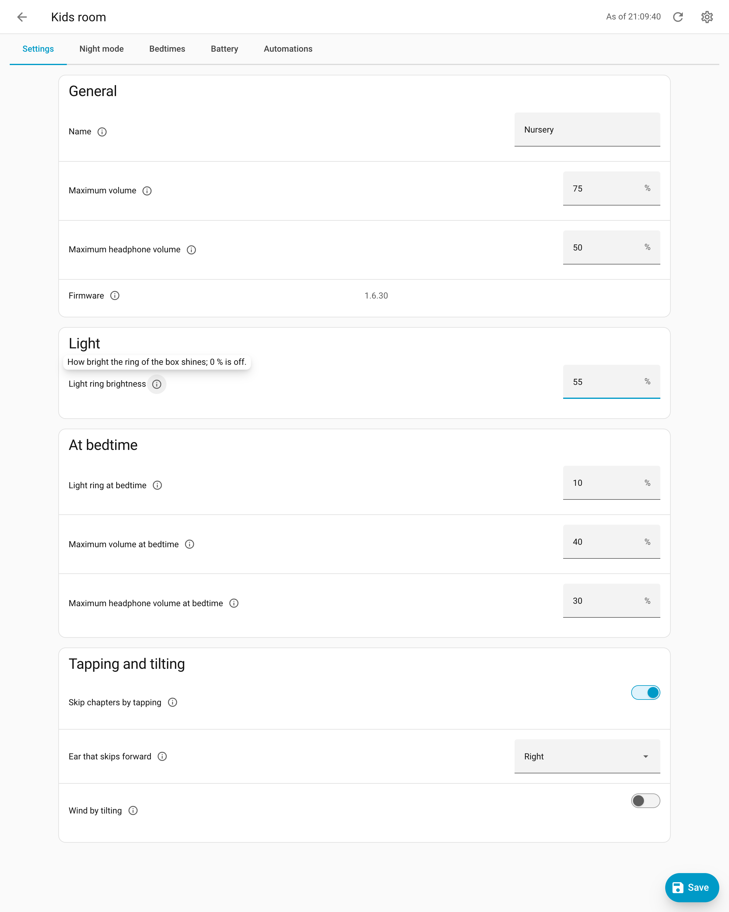

The night mode of the light ring, a view of the box:

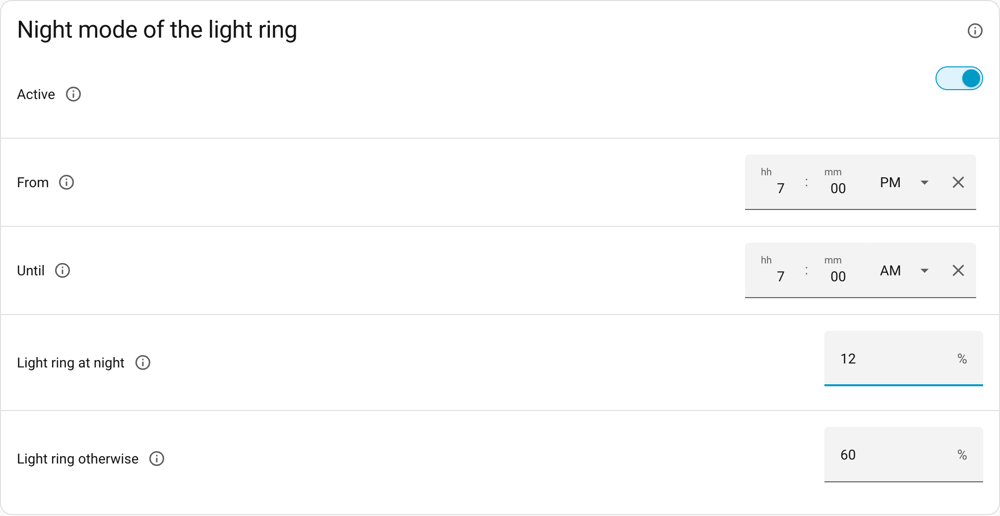

The preferences of an account in the area Setup:

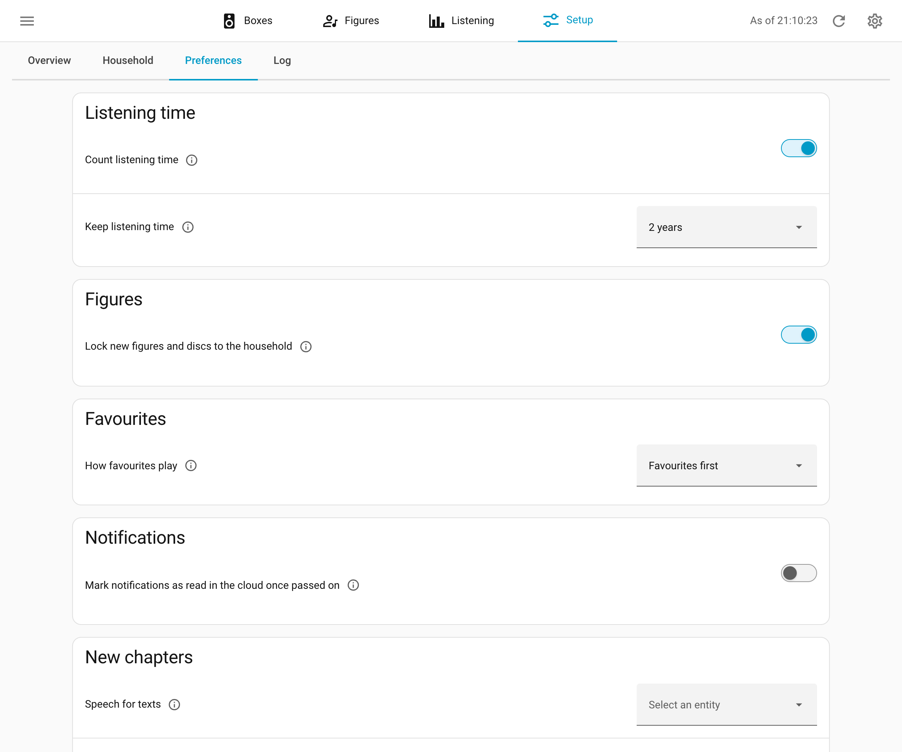

The next alarm on a box's card, set on the box, and the same box while its alarm rings:

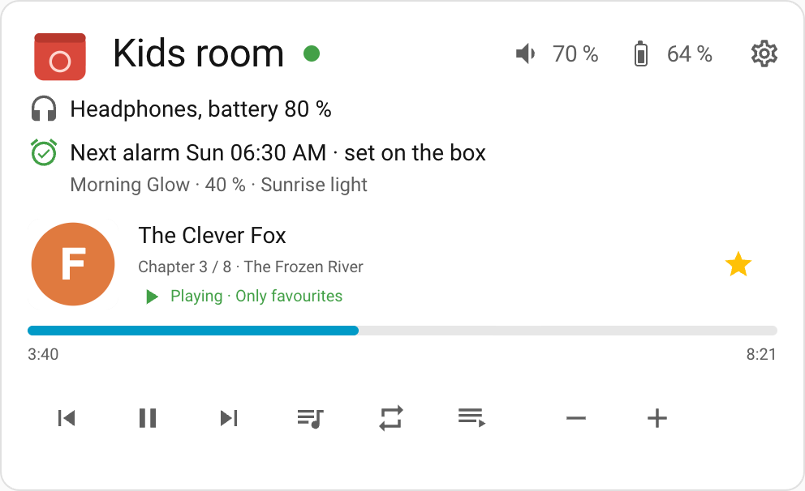 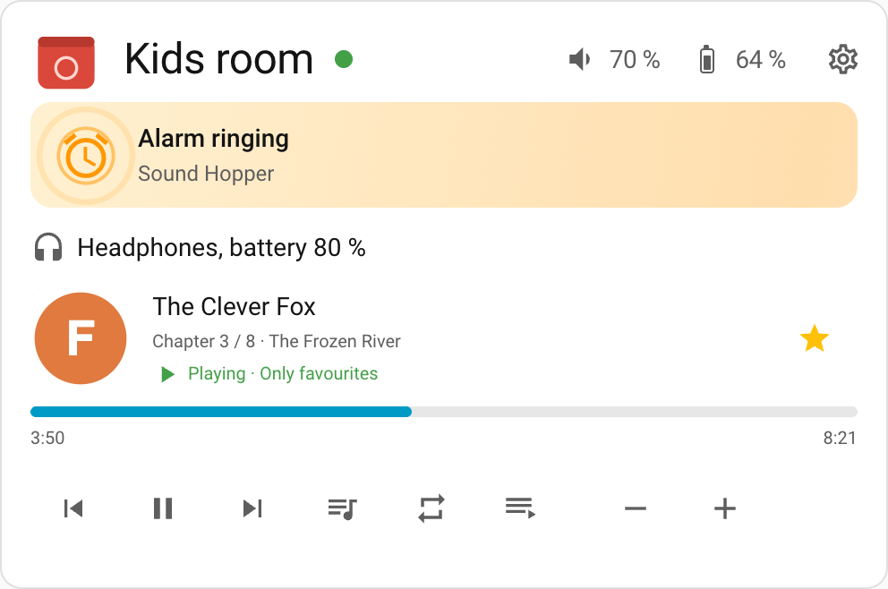

A new bedtime with its days, times and alarm:

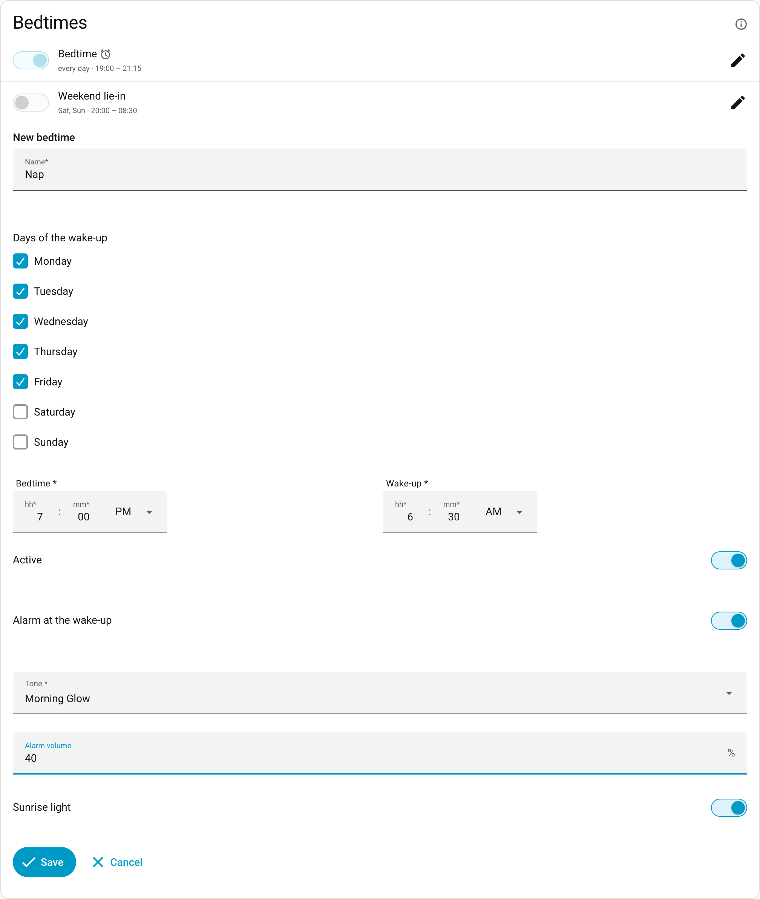

The chapters of a creative figure being rearranged, sorted by title or shuffled; the changes go to the cloud together when saved:

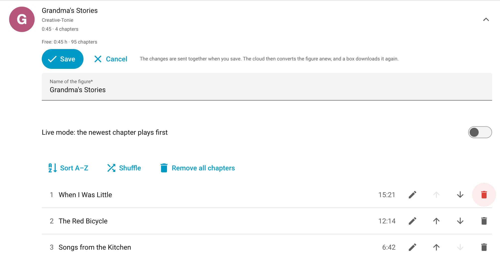

The listening times of the last 30 days, counted by Home Assistant:

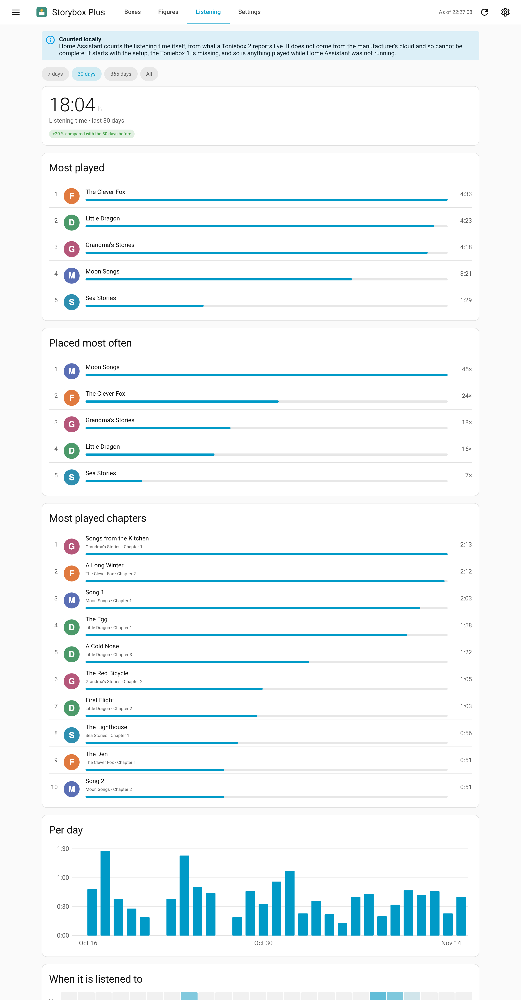

The boxes at phone width in dark mode:

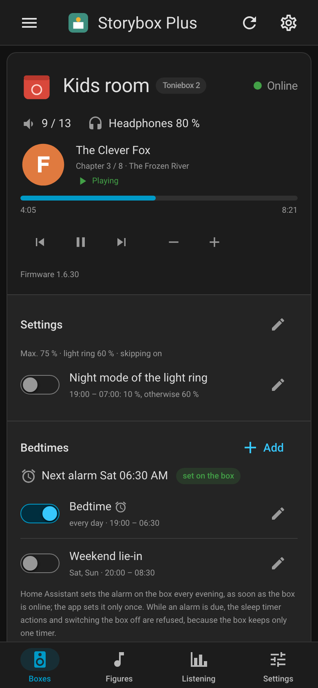

## Languages

The page, the dashboard card and everything Home Assistant shows of the integration (setup, entities, actions, messages) speak the languages tonies offers figures in: English, German, French, Spanish, Italian, Dutch, Polish and Brazilian Portuguese. They follow the language of the user's profile; any other language gets English. The page fetches the texts of a language other than English and German the first time it needs them, so for a moment it may show English. English and German are written by hand, the other languages are translated; corrections are welcome.

## Dashboard card

The integration brings a dashboard card, **Storybox Plus · Toniebox** in the card picker (`custom:storybox-plus-card`). It is for every user, not only administrators: it shows what plays on the Tonieboxes 2, whether a box is on, its battery, the volume, headphones, a running sleep timer and the next alarm, and it has the buttons of a media player. It is written for whoever lives with the box, not for whoever set it up. It leaves out what only administrators see: the settings, the bedtimes and the charge history. It loads with the integration and is kept in the dashboard resources; there is nothing to add by hand.

```yaml
type: custom:storybox-plus-card
```

Without any configuration it shows every Toniebox 2, one below the other. `entity` (the media player of a box) shows that one box.

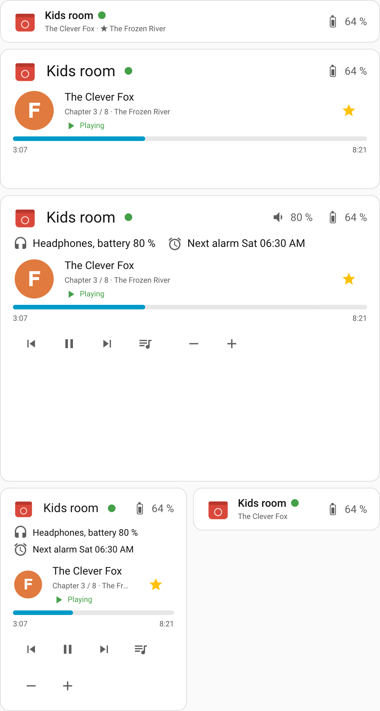

The card is as high as what it shows. Given fewer rows in a sections view, it shows what fits, the most important first:

1. the name of the box and whether it is online,
2. what plays: the figure, its chapter and the state,
3. the battery and the picture of the box,
4. the progress within the chapter,
5. the volume beside the battery, headphones, a running sleep timer, the next alarm, the night mode,
6. the buttons.

That makes three forms: **large** has everything, **medium** ends after the progress (4), **small** is one row with the name and one line of what plays (1 to 3; where that line is too long, the figure alone). The card takes the largest that fits; `size` sets one instead: `small`, `medium` or `large`. A tap on a small row opens Home Assistant's dialog of the box.

The large form lays itself out by its width: from 600 px what plays stands beside the facts and buttons, so it fits a wide, low tile such as half of a wall display (748 × 262 px); narrower it stacks, tighter, and still fits 370 × 262 px; under 300 px it is compact.

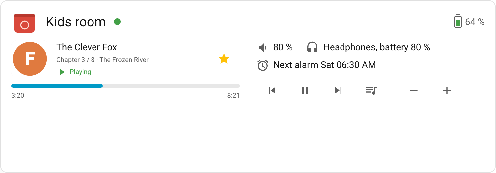

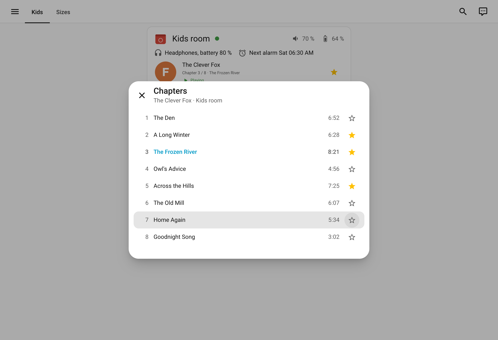

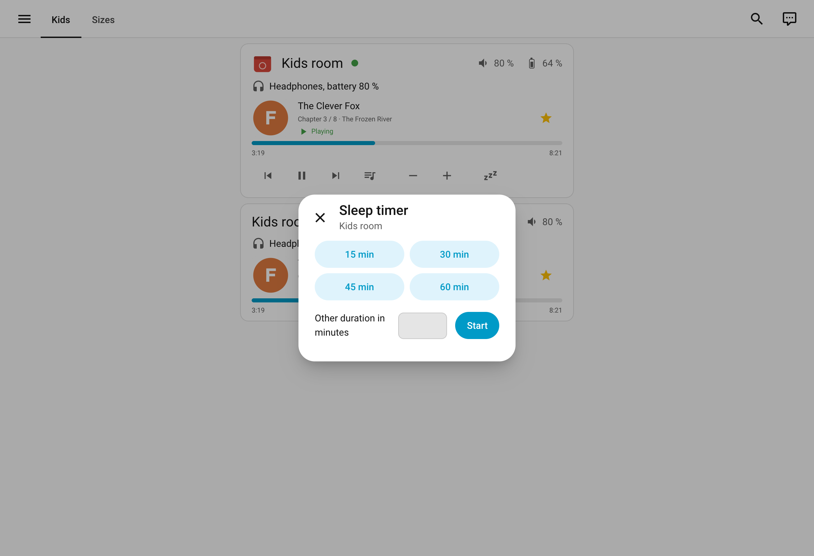

Every part can be switched on or off, in the card's editor or in YAML. All of them show unless turned off, but the night mode: it is for whoever set it up and shows once switched on.

| Option | |
|---|---|
| `entity` | the media player of one Toniebox 2; none: every Toniebox 2 |
| `title` | a name in place of the box's; with several boxes a heading above them |
| `size` | `small`, `medium` or `large`; none: by the space the card gets |
| `show_playback` | the figure that plays, its chapter and progress |
| `show_battery` | the battery's level |
| `show_picture` | the picture of the box |
| `show_volume` | the volume |
| `show_headphones` | the headphones while connected |
| `show_sleep_timer` | a running sleep timer |
| `show_next_alarm` | the next alarm (a bedtime's or the wake-up light), with a tick once the box carries it and its tone, volume and sunrise light as a tooltip; while it rings, the ringing band |
| `show_night_mode` | the chip of the light ring's night mode at work; off unless set to `true` |
| `show_controls` | the buttons |

The card reads entities and nothing else: the list of the boxes from the attribute of `sensor.<account>_tonieboxes_2`, the media player of each box and, by the integration's own keys, the sensors of the same device, so a renamed entity changes nothing and a disabled sensor leaves its part out. States and times read as Home Assistant writes them for the user's profile.

Its buttons are the one exception to reading, for what every user may operate on the media player anyway. They call `media_player.media_play`, `media_pause`, `media_next_track`, `media_previous_track`, `volume_up`, `volume_down`, `storybox_plus.set_sleep_timer` (from the sleep timer's dialog: 15, 30, 45 or 60 minutes or any other duration typed in) and `clear_sleep_timer`; the star beside the chapter that plays calls `storybox_plus.set_favourite`; and the button for the list of chapters opens the chapters of the figure in a dialog above the dashboard, where a chapter chosen plays from its start (`media_player.play_media`) and a star marks it. Each is called on the box's media player; a refused press reads one line. While the alarm of a bedtime is due, the sleep timer's button is left out.
